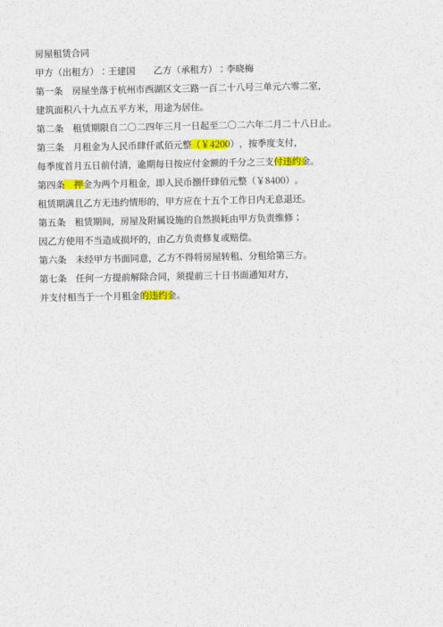

# 附录 A01（技术向）扫描版中文 PDF 变成"能搜索、能复制"的 PDF：全程离线，不上传

> 实测日期：2026-11-07（美东时间）
> 实测环境：Debian Linux，Python 3.13，8 核 CPU，无显卡
> 本期所有数字都来自 [`assets/A01/`](assets/A01/) 里的日志，可以自己复现。

## 要解决的问题

手上有一份扫描版合同、老资料或盖章文件，PDF 里其实是一张张图片：
按 Ctrl+F 搜不到"押金"，想复制一段条款也复制不出来。

常见做法是把文件传到在线 OCR 网站或某个 App。问题是合同里有姓名、地址、金额，
很多人不想上传；免费版还常限制页数或加水印。

本期做的是：**在自己电脑上离线**把扫描 PDF 变成"双层 PDF"——
外观和原件一模一样（还是那张扫描图），但底下多了一层看不见的文字，
可以搜索、复制，也能导出成 txt 给 AI 做总结。

本期实测里踩到了两个网上教程基本没提的坑（见"会卡在哪里"），这也是本期的重点：

1. 用错字体，文字层看着对，但搜"押金""违约金"**一个都搜不到**；
2. 页面歪了 4 度，**整行整行地漏识别**，准确率从 99% 掉到 83%。

## 工具组合

| 工具 | 作用 | 费用 |
|---|---|---|
| [RapidOCR](https://github.com/RapidAI/RapidOCR)（`rapidocr_onnxruntime`） | 中文识别，模型来自 PaddleOCR，安装包里自带模型，不用另外下载 | 免费，开源 |
| [PyMuPDF](https://github.com/pymupdf/PyMuPDF) | 把 PDF 页面转图片，再把识别出的文字写回 PDF | 免费，开源（AGPL） |
| Python 3 | 运行脚本 | 免费 |

不需要注册任何账号，不需要 API Key，不需要显卡，识别过程不联网。

## 步骤和提示词

本期不用 AI 聊天提示词，用的是一个现成脚本，复制即可。

### 第 1 步：安装（实测 15 秒）

```bash
python3 -m venv ocr-env
source ocr-env/bin/activate
pip install rapidocr_onnxruntime pymupdf pillow
```

实测装上的版本见 [`requirements_tested.txt`](assets/A01/requirements_tested.txt)。

### 第 2 步：保存脚本

把 [`ocr_pdf.py`](assets/A01/ocr_pdf.py) 下载到同一个文件夹。它做四件事：

1. 每页按 200 DPI 转成图片，交给 RapidOCR 识别；
2. 用识别出的文字框算出整页歪了几度，超过 0.5 度就先转正再识别一次；
3. 把文字以"隐形文字"（`render_mode=3`）写回原页面对应位置，并横向拉伸到和图上的字一样宽；
4. 另存一份纯文本 `输出文件名.txt`。

脚本里两行最关键的设置：

```python
fontname="china-s",   # 用PDF内置中文字体，不要嵌入Noto等字体文件
render_mode=3,        # 隐形文字：看不见，但能搜、能复制
```

### 第 3 步：运行

```bash
python ocr_pdf.py 你的扫描件.pdf 输出.pdf
```

实测输出（[`ocr_run_log.txt`](assets/A01/ocr_run_log.txt)）：

```
第1页: 倾斜 -1.2°，识别 15 行
第2页: 倾斜 -1.2°，识别 10 行
完成，用时 7.8 秒 -> output_searchable.pdf
总耗时(含加载模型) 8.3 秒
```

### 第 4 步：验收（别跳过）

用任意 PDF 阅读器打开 `输出.pdf`，Ctrl+F 搜几个文件里一定有的词，
**重点搜金额、日期、人名**。本期用 [`check.py`](assets/A01/check.py) 自动验收，
和原文逐字对比（[`check_log.txt`](assets/A01/check_log.txt)）：

```
原文 541 字，识别 536 字，字符匹配率 98.8%
搜索「押金」: 命中页 [1]
搜索「违约金」: 命中页 [1]
搜索「4200」: 命中页 [1]
搜索「8400」: 命中页 [1]
搜索「优先承租权」: 命中页 [2]
搜索「李晓梅」: 命中页 [1, 2]
去掉标点后：原文 490 字，汉字/数字匹配率 100.0%
```

（98.8% 和 100% 的差别全在标点：OCR 会漏掉或改动部分逗号、句号。）

搜索高亮效果（[`search_hit_page1.png`](assets/A01/search_hit_page1.png)）：



### 第 5 步（可选）：把文字交给 AI

`输出.txt` 是纯文本，可以粘贴给任意 AI 聊天工具做总结。
本期没有测试这一步的 AI 回答质量，所以不提供提示词。
如果你在意隐私，注意这一步会把内容发给 AI 服务商，前面四步的"离线"就不成立了。

## 测试材料是怎么来的

为了能逐字算准确率，测试文件是用 [`make_scan.py`](assets/A01/make_scan.py)
自己生成的"模拟扫描件"：一份两页的虚构租房合同（[`ground_truth.txt`](assets/A01/ground_truth.txt)，
人名地址均为虚构），渲染成灰底图片，加 6 万个噪点、高斯模糊、倾斜，再存成纯图片 PDF
（[`input_scanned.pdf`](assets/A01/input_scanned.pdf)，打开后确认文字层为空）。

这意味着：**本期没有用真实手机拍照或真实扫描仪的文件测试。**真实文件可能更糟（阴影、折痕、
红章压字），结果请以你自己第 4 步的验收为准。

## 实际花费

| 项目 | 实测 |
|---|---|
| 金钱 | 0 元 |
| 安装 | 约 15 秒（pip 从 PyPI 下载，海外网络） |
| 2 页 A4 识别 | 8.3 秒（含加载模型；8 核 CPU，无显卡） |
| 输出文件大小 | 输入 770 KB → 输出 776 KB |

## 会卡在哪里、什么情况不值得做

**坑 1：字体选错，文字层"看着对、搜不到"（实测）**

第一版脚本嵌入了系统里的 Noto CJK 字体。识别本身没错，但写进 PDF 后再读出来，
"金、不、年、度、李、落、路、六"这些字变成了外形相同、编码不同的"兼容汉字"
（例如 `金` 变成 U+F90A，正常应是 U+91D1）。结果是：

```
搜索「押金」: 命中页 []
搜索「违约金」: 命中页 []
搜索「李晓梅」: 命中页 []
去掉标点后：汉字/数字匹配率 94.0%
```

（完整日志：[`check_log_bad_font.txt`](assets/A01/check_log_bad_font.txt)）
换成 PyMuPDF 内置的 `china-s` 字体后全部搜得到。文件也小得多：同一份输入，嵌入字体版 15 MB，内置字体版 1.3 MB。
**教训：做完一定要实际搜几个词，不能只看文字导出得对不对。**

**坑 2：页面歪了，整行漏掉（实测）**

把同一份合同倾斜 4 度、模糊加重后测试，不做纠偏时：

| 测试条件 | 不纠偏 | 加纠偏后 |
|---|---|---|
| 倾斜 1.2°，轻度模糊（默认） | 99.9% | 100.0% |
| 倾斜 4°，轻度模糊 | 83.5% | 99.7% |
| 倾斜 4°，重度模糊 | 76.9%，「4200」「8400」搜不到 | 95.9%，全部关键词搜得到 |

（数字为去掉标点后的汉字/数字匹配率。日志：
[`check_log_hard_before_deskew.txt`](assets/A01/check_log_hard_before_deskew.txt)、
[`check_log_rot4_after_deskew.txt`](assets/A01/check_log_rot4_after_deskew.txt)、
[`check_log_hard_after_deskew.txt`](assets/A01/check_log_hard_after_deskew.txt)）

本期脚本已经内置纠偏。纠偏后识别时间约为原来的 2 倍（每页多识别一次）。

**坑 3：重度模糊时仍会错字和漏字**

重度模糊组纠偏后还有约 4% 的错漏，例如「贰」识别成「赋」、「逾」识别成「途」。
金额、日期、人名这类关键信息，**必须对照原件人工核对**，不能直接拿 OCR 结果当证据。

**坑 4：搜索高亮可能偏一两个字**

隐形文字的位置是按识别框估算的，高亮有时会偏一两个字（见上图「押金」）。
不影响搜索和复制。

**什么情况不值得做：**

- 只有一两页、只是想看一眼内容：直接用手机相册自带的"识别文字"更快。
- 文件本来就能选中文字（不是扫描件）：不需要这一套。
- 竖排古籍、手写体、表格很多的文件：本期没有测试，不要默认能用。
- 你完全不想碰命令行：这套需要运行 3 条命令。

## 国内路线与国际路线

- **已实测**：国际路线——从官方 PyPI 安装，在 Linux 上运行。
- **测试未通过**：国内镜像——本机访问清华 PyPI 镜像（`pypi.tuna.tsinghua.edu.cn`）
  时找不到 `rapidocr_onnxruntime`，原因是本机网络连不上该镜像，不代表镜像没有这个包。本期不给出国内镜像的安装命令。
- **未测试，所以不写**：Windows、macOS 上的安装步骤。
- 识别和写回 PDF 这两步不联网，国内外没有差别。

## 30 分钟第一步

1. 装好 Python 3（已有可跳过）。
2. 运行第 1 步的 3 条命令。
3. 先下载本仓库的 [`input_scanned.pdf`](assets/A01/input_scanned.pdf) 跑一遍，
   确认你的输出和上面的日志差不多。
4. 再换成你自己的一份扫描件，Ctrl+F 搜三个词：一个金额、一个日期、一个人名。
   三个都搜到了，再处理整批文件。

## 实测日期

2026-11-07（美东时间）。依赖版本见 [`requirements_tested.txt`](assets/A01/requirements_tested.txt)。
