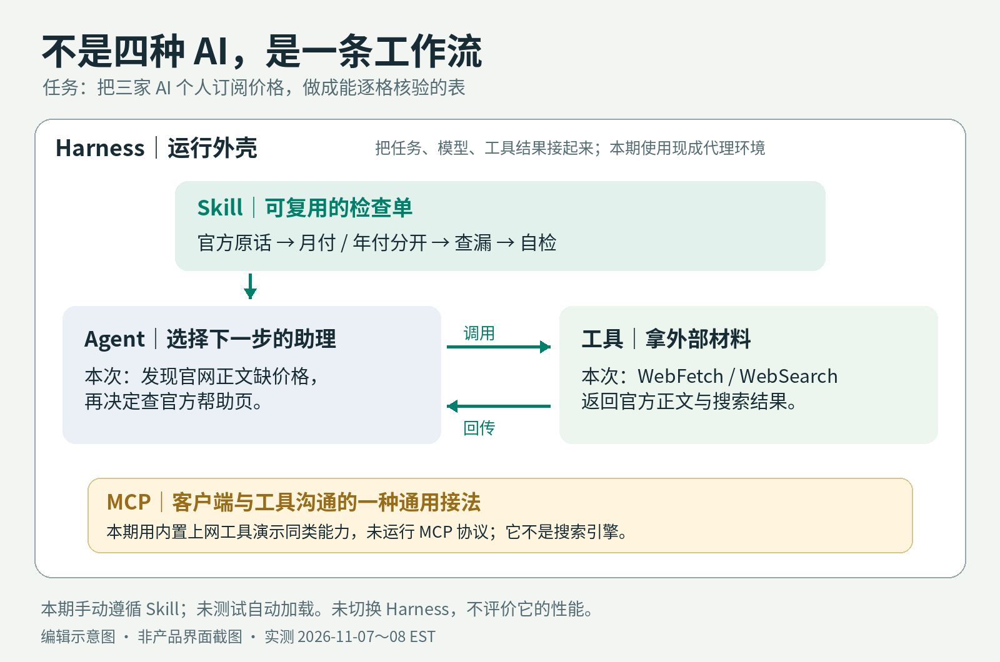
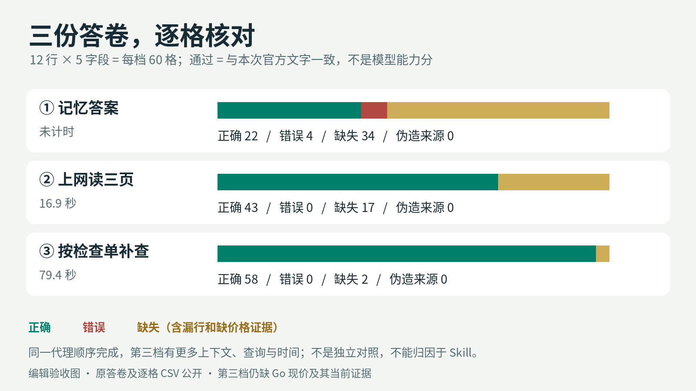
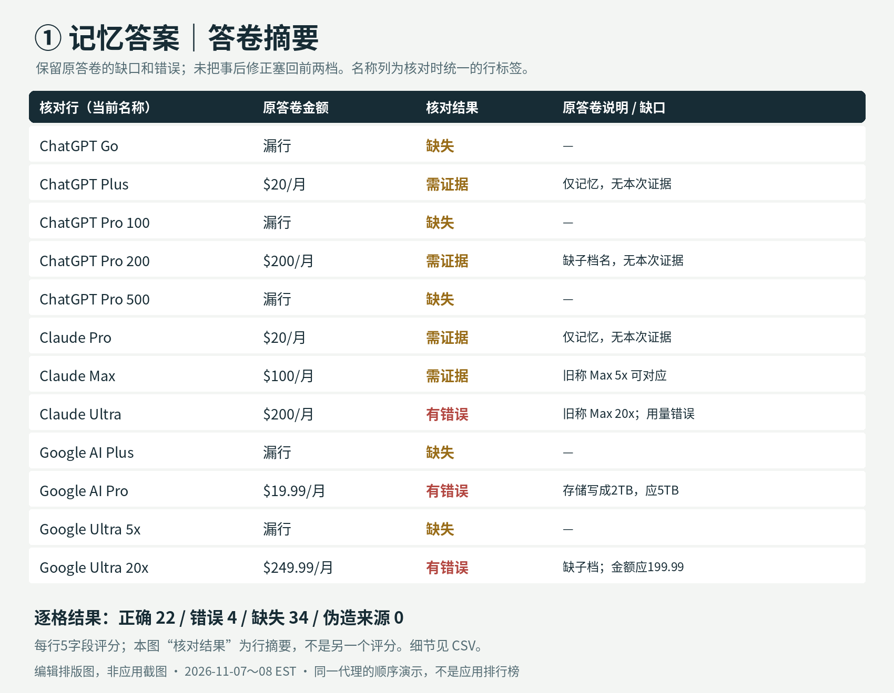
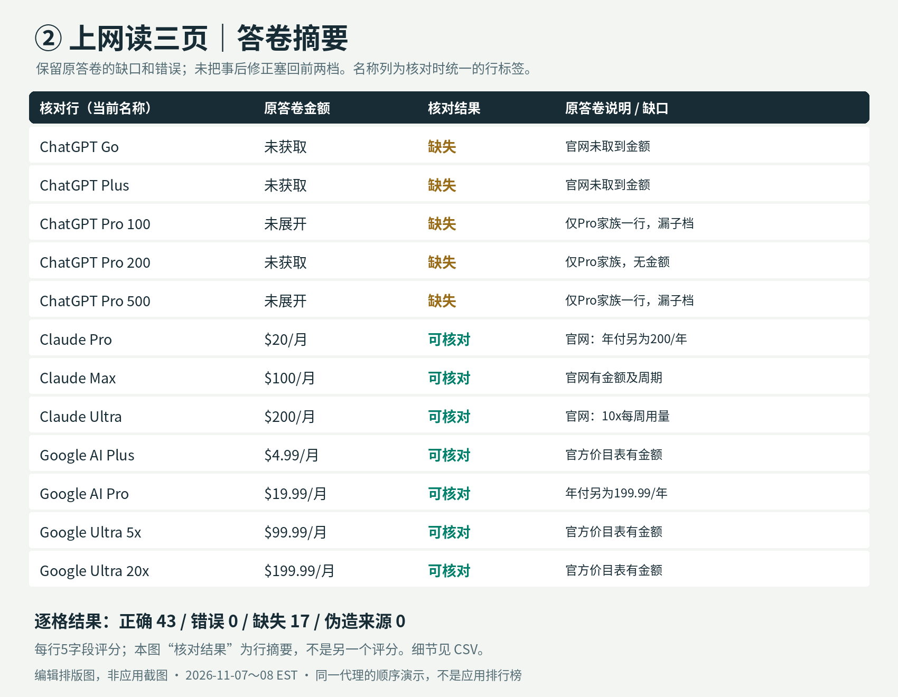
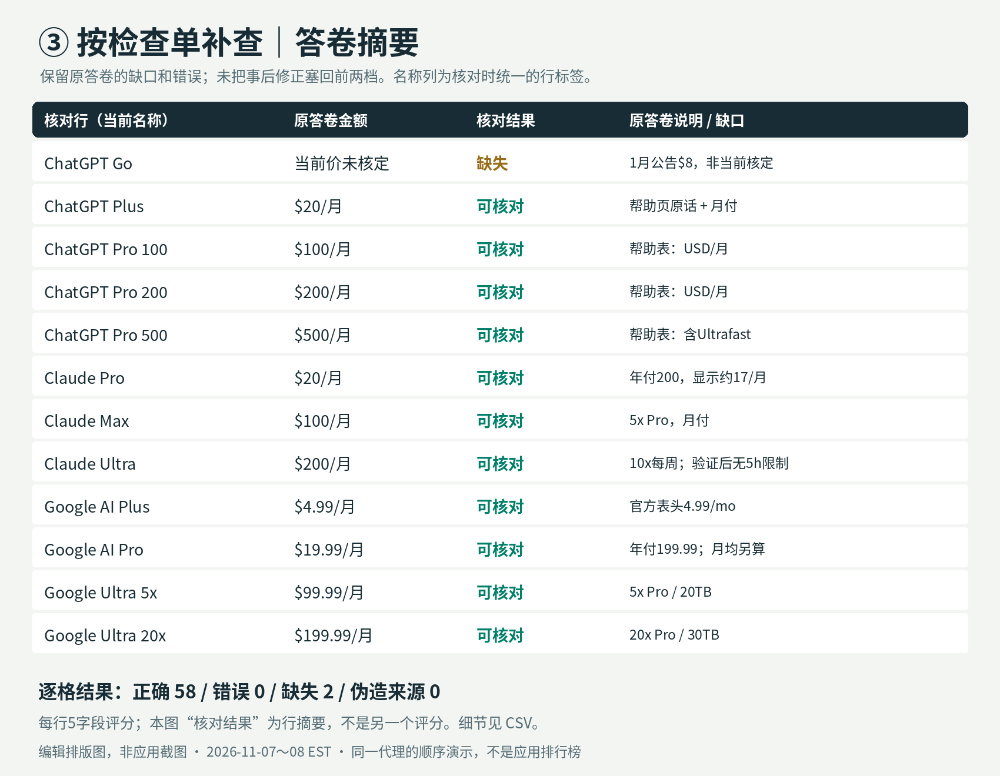

# 001｜别再为名词付费：用一张订阅表，拆开 Agent、MCP、Skill、Harness

> 一次可追溯的工作流演示，不是三家应用排行榜。ChatGPT、Claude、Gemini 是**被查询的对象**，不是三位答题选手。无订阅购买，无登录，无付费功能体验测试。

## 一句话结论

**模型负责判断，工具拿新材料，Skill 规定怎样交卷，Harness 管整个过程；名字再多，也不能代替“这格数字的证据在哪里”。**

同一个查价任务，记忆答案把 Claude 的旧档位和 Gemini 的旧价带进来；上网后能纠正，但官方价格页并不一定把所有金额交给抓取器；按检查单继续查官方帮助页，才补齐多数缺口。**最后仍有一项现价没有核定，不能把“有联网、有 Skill”当作保证正确。**



[三档原答卷](assets/001/redo/runs/) · [逐格验收](assets/001/audit.md) · [单屏推广图](assets/001/screenshots/summary.png)

## 要解决的问题

你打开一个 AI 说：“我想知道现在三家个人付费版分别多少钱。”它立刻给出一张漂亮表格。问题是：它是在回忆，还是刚查过？$17 是每月扣款，还是一年先付 $200？一个叫 Pro 的档位，是否又分了子档？

这不是教你收集更多工具。交付物只有一个：**每个价格都能找到原文、周期和日期的订阅对照表**。不懂代码的人也能检查它。商家价目、软件套餐、供应商报价，同样需要这条证据链；这些延伸用途本期没有另测，也不编收入数字。

## 四个词人话版

| 词 | 人话 | 本次实际看见了什么 | 别误会 |
|---|---|---|---|
| **Agent：能办多步事的助理** | 不只回答，还会选工具、看返回结果、决定下一步 | 第三档看到 ChatGPT 价格正文缺金额，转查官方帮助页，找出 Pro 100 / 200 / 500 | 它不保证判断正确；第二档只查三页就停了 |
| **MCP：工具的通用接法** | 像插座规范，负责让客户端与工具沟通，不是搜索引擎或新模型 | 本期真正调用的是现成 WebFetch / WebSearch；它们展示“接外部资料”这件事，**没运行 MCP 协议** | 图中 MCP 只是可替换的接法；本期没有证明安装 MCP 有性能提升 |
| **Skill：可重复使用的作业检查单** | 把“先查官网、摘价格原话、分月付年付、交卷自检”写成文件 | 第三档手动阅读 SKILL.md，再按它补查、附原话，保留一个没核定的现价 | 文件不会自己联网；本期没有自动发现、安装或加载 Skill |
| **Harness：办事的运行外壳** | 把任务、模型、工具结果接起来，管状态和边界 | 本次现成代理环境让模型发出调用、收到网页再继续；我们另存答卷、时间和验收表 | 没自建或切换 Harness，没测恢复/沙箱/调度性能；日志整理不等于完整 Harness |

**给普通人的决定：**已有能联网的聊天工具，先用它加一份检查单。不必为了查三家价格先装 MCP，也不用再为“Harness”这个词开一个订阅。

## 实测设计

### 同一份任务

```text
我想知道现在（2026年11月）ChatGPT、Claude、Gemini 这三家给个人用户的付费档分别多少钱。请做一张表：产品 | 档位名称 | 美元月费 | 比免费版多了什么（一句话）| 出处链接。每个价格都要写清楚出处。
```

[原始任务文件](assets/001/task_prompt.txt)未改。执行者是**当前大型语言模型代理**，无法核实底层供应商或版本，不冒认某一品牌。

| 档 | 怎么做 | 记录 |
|---|---|---|
| ① 普通聊天，无上网 | 先仅凭记忆写答案并保存；然后才查网页。没有把旧调试结果当记忆答案 | [原答卷](assets/001/redo/runs/level1.md)、[保存时间](assets/001/redo/logs/level1.json) |
| ② Agent + 上网工具 | 读取三家官方定价页，按已获取文字做表，没有补充搜索；查不到的价格留空 | [原答卷](assets/001/redo/runs/level2.md)、[3次抓取记录](assets/001/redo/logs/level2.json) |
| ③ Agent + 工具 + Skill | 手动读取修订好的检查单，再读三页；金额缺失就补查官方帮助与公告，写原话和自检 | [原答卷](assets/001/redo/runs/level3.md)、[7次抓取+2次搜索记录](assets/001/redo/logs/level3.json) |

**先说局限，避免把演示伪装成实验排名：**三档由同一代理顺序完成，非独立会话，第三档看过前面材料，知道前面的缺口，也花了更多时间、做了更多查询。第二档停在三页，是这次工作的停止选择，不是 Agent 的能力上限；它完全可能继续搜索。本期没有控制查询次数、上下文或时间，没有盲评。因而只能说“这次检查单让工作步骤可见”，**不能把差值归因于 Skill，更不能说不装 Skill 就会错。**

第一档的“无工具”指回答阶段没有联网、未查外部价格；它仍有训练记忆及父对话背景，不是无先验模型。第三档的 Skill 是人工阅读并遵循，不是系统自动加载。三档都是各一次，不报成功率。

### 怎么核对

从本次抓取的[官方文字节选](assets/001/redo/evidence/)建立[参考表](assets/001/redo/ground-truth.json)，当前可识别的个人档及用量子档共 12 行；每行核对 5 格：产品、档位、月费与周期、功能、当前价格证据，共 60 格。

- **正确**：与保存的官方文字一致；不代表用户账户的最终结账价。
- **错误**：明确与官方文字冲突。
- **缺失**：漏档位、缺现价、缺子档，或没有本次取到且支持现价的出处。
- **伪造来源**：捏造链接或引文。未访问但已坦承的链接不冒充伪造，算缺证据。

参考材料与答卷来自同一抓取服务，执行者也兼任核验者，因此可能存在共同错误。保存的是标明出处、时间的返回正文**节选**，不是全站镜像或浏览器截图；抓取服务可能使用缓存。没有偷偷把文字排版图叫成官网截图。

## 三档结果对比



| 档 | 正确 | 错误 | 缺失 | 伪造来源 | 记录墙钟时间 |
|---|---:|---:|---:|---:|---|
| ① 记忆答案 | 22 | 4 | 34 | 0 | 未连续计时，不作速度比较 |
| ② 上网，读三页 | 43 | 0 | 17 | 0 | 16.9秒 |
| ③ 按检查单补查 | 58 | 0 | 2 | 0 | 79.4秒 |

二、三档计时包含查阅、思考和保存答卷，不是纯模型延迟；页面可能缓存，不能拿它预测你的执行速度。**这是这三份答卷的验收，不是“AI 准确率从多少涨到多少”。**缺失数量还包括没展开的整行，不等于只差几个金额。

### ① 只凭记忆：不是完全不会，而是会把旧资料写得很顺

Claude 的 $20、$100、$200 等金额确实记对了一些。但是把最高档写为“Max 20x”，本次官网已是 Ultra，写的是每周 10x Pro；Gemini Pro 仍写 2 TB，本次官网为 5 TB；Gemini 最高档记成 $249.99，本次对应 20x 为 $199.99。

第一档主动说明不能核实当前价，没有伪造访问。记忆中的链接不等于今天访问过的依据。不要让“有链接”给旧信息镀金。



### ② 接上工具：错的少了，缺口不会自动消失

Claude 和 Google 页面给出了当前档位与金额；ChatGPT 返回文字列出 Go、Plus、Pro，却没有金额，Pro 还只说“3 usage tiers”。因此第二档没有拿记忆中的 $20 填空。

这一步最重要的不是图变漂亮，而是**知道材料缺在哪里**。三个成功返回的网页，不等于所有价格都拿到了。第二档没有继续查，是本次不完整交付，不能称为已查全。



### ③ 加检查单：把补查、条件和自检固定下来

检查单要求遇到缺价就补查官方帮助，当前 Pro 帮助表明确列出了 100 / 200 / 500 三个子档。Claude 的年付显示 $17/月与月付 $20 被分开；Google Pro 的月付 $19.99 与全年 $199.99 也分开。每个已确认金额附原话，不让读者只看到一个泛泛的链接。

但 Go 只有 1 月公告写美国 $8/月，当前定价页文本没取到金额，当前帮助页又指回定价页。**今天抓到旧公告，不等于今天核定现价。**所以最终仍缺“Go 当前金额”和“支持当前金额的出处”两格；不宣布最便宜，也不建议按历史价购买。



### 最终可核对的表

| 产品 | 档位 | 美元月付及年付说明 | 比免费版多什么（一句话） | 官方价格原文与出处 |
|---|---|---|---|---|
| ChatGPT | Go | **11月现价本次未获取**；1月官方公告曾为美国 $8/月 | 更多工具、图像和文件用量。 | “In the US, Go is available for $8 per month.” [1月公告](https://openai.com/index/introducing-chatgpt-go/)；[当前帮助页](https://help.openai.com/en/articles/11989085-what-is-chatgpt-go)未列金额。旧公告不能单独核定11月价。 |
| ChatGPT | Plus | $20/月；无年付 | 更高模型限额及推理、文件和研究功能。 | “Price: $20/month (billed monthly).” [官方帮助](https://help.openai.com/en/articles/6950777-what-is-chatgpt-plus) |
| ChatGPT | Pro 100 | $100/月；无年付 | Pro 模型和更高工具用量。 | “Pro 100 | $100 | Not included” [官方 Pro 表](https://help.openai.com/en/articles/9793128-about-chatgpt-pro-tiers)，表头为 Monthly price (USD)。 |
| ChatGPT | Pro 200 | $200/月；无年付 | Pro 系列功能，用量高于 Pro 100。 | “Pro 200 | $200 | Not included” [同一官方表](https://help.openai.com/en/articles/9793128-about-chatgpt-pro-tiers) |
| ChatGPT | Pro 500 | $500/月；无年付 | Pro 系列最高用量，含 Ultrafast。 | “Pro 500 | $500 | Included” [同一官方表](https://help.openai.com/en/articles/9793128-about-chatgpt-pro-tiers) |
| Claude | Pro | $20/月；也可 $200/年预付，官网显示约 $17/月 | 更多用量、更多模型与 Claude Code。 | “Per month with annual subscription discount ($200 billed up front). $20 if billed monthly.” [定价页](https://www.anthropic.com/pricing) |
| Claude | Max | $100/月；月付 | Pro 的 5 倍用量。 | “Max” / “$100” / “5x Pro usage every 5 hours and every week*”；FAQ：“Both plans are billed monthly.” [定价页](https://www.anthropic.com/pricing) |
| Claude | Ultra | $200/月；月付 | Pro 的 10 倍每周用量，已验证账户无 5 小时限制。 | “Ultra” / “$200” / “10x Pro usage every week*”；“No 5-hour limit for verified accounts.” [定价页](https://www.anthropic.com/pricing) |
| Gemini | Google AI Plus | $4.99/月；本次未取得年付信息 | 更高 AI 用量及云存储。 | “Google AI Plus $4.99/mo” [定价表](https://one.google.com/about/google-ai-plans/) |
| Gemini | Google AI Pro | $19.99/月；也可 $199.99/年，月均约 $16.67（计算值） | 扩展 Gemini 用量及 5 TB 存储。 | “Monthly ($19.99)” / “Annual ($199.99)”；“Google AI Pro $19.99/mo” [定价页](https://one.google.com/about/google-ai-plans/) |
| Gemini | Google AI Ultra 5x | $99.99/月；本次未取得年付信息 | Pro 的 5 倍 Gemini 用量及 20 TB 存储。 | “Google AI Ultra 5x $99.99/mo” [定价表](https://one.google.com/about/google-ai-plans/) |
| Gemini | Google AI Ultra 20x | $199.99/月；本次未取得年付信息 | Pro 的 20 倍 Gemini 用量及 30 TB 存储。 | “Google AI Ultra 20x $199.99/mo” [定价表](https://one.google.com/about/google-ai-plans/) |

**读表边界：**这是公开英文美元页面的记录，不代表中国大陆可用性、任何当地币种、App Store 价或账号促销。Claude 页面明确不含适用税；其他页面没有拿到完整税费说明，不统一称“税前价”或“税后价”。Google Pro 年付月均约 $16.67 是计算值，Claude 官网的 $17 是取整展示，实际一年预付 $200。

## 可复制提示词和 SKILL.md

先复制上面的原始任务。需要重复做时，再加下面这份检查单；没有 Skill 系统也可以把步骤直接贴进聊天，并要求按清单交卷。**这条“直接粘贴”路线本期没有另做独立对照，不承诺效果相同。**

````markdown
---
name: compare-subscriptions
description: 查个人订阅价格；金额必须绑定官方原文、周期、地区和查询日期，发布前自检。
---

# 个人订阅查价检查单

## 输入
产品、查询月份、个人版、目标币种和地区。没指定地区时，明确声明使用公开英文美元页，不能声称已验证用户当地结账价。

## 步骤
1. 先读每家官方定价页。只查个人付费档，不把 API、团队版混进来。
   - https://openai.com/chatgpt/pricing/
   - https://www.anthropic.com/pricing
   - https://one.google.com/about/google-ai-plans/
2. 列齐页面上的档位和用量子档。每个价格附官方 URL 和一段逐字原文；不能只贴首页。记录抓取时间，保存返回文本。
3. 月付单列；年付写全年预付总额和官方显示的月均值。官网若只写约数，不能伪称精确月均；算术折算必须标“计算值”。促销另列，不能当常规价。
4. 定价页没抓到金额时，只在官方域名内补查帮助文档、官方公告，并再次打开来源核实。没有原文支持就写“本次未获取”，不得凭记忆补，也不能把附赠福利的价值当订阅价。
5. 写清币种、地区/账号/渠道差异、税费是否明确；页面没说明不硬补。不要为查价进入登录或付款，不订阅，不使用第三方代充。
6. 功能用一句话，限页面明确支持的内容；“不限”不能扩大到所有功能和所有时段。

## 发布前自检（必须输出）
- 逐项核对：产品 / 档位 / 金额与周期 / 功能 / 可追溯原文。
- 所有个人子档都列了吗？年付折算误写成月付了吗？旧名称或脚注混进名称了吗？
- 每个金额在保存的官方文字中找得到吗？相互冲突就并列说明，不强行取一个。
- 有缺口就列缺口，不宣布“完整”“最便宜”“值得买”。

## 输出
五列表格（产品 | 档位 | 美元月费及年付说明 | 比免费版多什么 | 官方 URL + 价格原文），然后查询日期、地区/税费提醒、自检和缺口清单。

````

[下载 SKILL.md](assets/001/skill/compare-subscriptions/SKILL.md)。它是工作标准，不是神奇提示词；模型没按标准做，就人工拦下来。

## 实际花费

| 项目 | 本次能确认的事实 |
|---|---|
| 新增订阅、API Key 或购买 | 没有购买、充值、启用试用或输入支付资料；没调用匿名免费模型端点 |
| 模型与联网使用 | 使用已有代理环境的模型、WebFetch 和 WebSearch；其运行可能计入宿主服务额度，不等于全世界免费 |
| 本次能报出的新增现金支付 | 无支付动作；**不是对账号总账单的0元审计** |
| 调用数 | 第二档3次抓取；第三档7次抓取+2次搜索。合计10次抓取、2次搜索 |
| token 或精确推理费用 | 环境未返回可审计 usage/账单，不能计算 |
| 时间 | 二、三档分别16.9秒和79.4秒，只计各自答题窗口；第一档与文章/制图工时没有连续计时，不编总工时 |

不需要为了读本文再订阅三家的付费版。只有查询公开资料，不是测试付费权益，不证明能省多少钱或挣多少钱。

## 会卡在哪里、谁不需要

| 症状 | 先做最少的一步 |
|---|---|
| 官网页面打开了，却没金额 | 先检查返回文本，不猜；补查官方帮助，仍没找到就留缺口 |
| 搜出官方旧公告 | 同时写发布日期和抓取日；历史价与当前价分开，不能只写“官网说” |
| 大标题$17，月付却$20 | 看计费周期、全年预付总额，不只抄最大字号 |
| 工具返回“成功” | 检查拿到的是否是正确产品、正确个人档、完整价格条件 |
| 不知道该装什么 | 已有联网功能就先用；反复跨软件读写，才研究连接器/MCP；步骤常重复才固化 Skill |

你偶尔查几页、资料已经在手上、或者不愿维护一套自动系统，就**不需要自建 MCP 或 Harness**。熟悉领域的人手工打开三页也许更快，本期没计时测试这条路线，不报节省比例。真正值得自动化的是反复发生、验收标准明确的工作，而不是为了显得高级而堆组件。

## 国内与国际路线

- **本期实际路线**：现成代理 + 两种上网工具 + 三家公开英文官网；无账号登录，不评价其在不同网络地区的可用性。
- **国内应用本期没有实测**：豆包、千问、DeepSeek、元宝、智谱、Kimi、WorkBuddy 等没有进入本次答题对照。不能把本期分数安在它们头上，更不能拿网上评测冒充本期数据。
- **可迁移的是验收方法，不是品牌结论**：看你现有工具能否拿到原文、有没有出处、能否按清单留缺口。先确认这件事，再谈组合。国内工具免费额度与具体操作等后续真实测试完成后再写。

## 30分钟第一步

这是一份建议时间安排，不是另一次计时完成的实验。

1. **0–5分钟**：只选一个你真想办的任务。比如核对你准备保留的三项订阅；写明个人版、地区、币种、月付。
2. **5–15分钟**：用现有联网工具配合本期提示词。要求每格带金额原话、URL、查询日；网页没价格就列缺口。
3. **15–25分钟**：逐行查月付/年付、档位与子档、功能和引文。确认日期是抓取日还是公告日。
4. **25–30分钟**：只保留核对过的行；未确认的别拿去付款或公开推荐。把这次踩坑写进下一次的检查单。

你得到的第一件东西应该是一份能核验的作业，不是四个新订阅。

## 实测日期

记忆答案与第二档：**2026-11-07 23:59 EST**；第三档跨过午夜，**2026-11-07 23:59 至 2026-11-08 00:01 EST**。具体保存时间和调用窗口见[日志](assets/001/redo/logs/)。这是一次跨午夜的演示，不伪装成另一天反复复测。

价格仅描述本次返回文字；服务可能缓存，未验证账户结账价。截图式排版图均为编辑制图，原答卷、官方文字和逐格 CSV 一并公开。旧 OCR 内容保留在[技术附录 A01](../appendix/A01-scanned-pdf-searchable-offline.md)。
