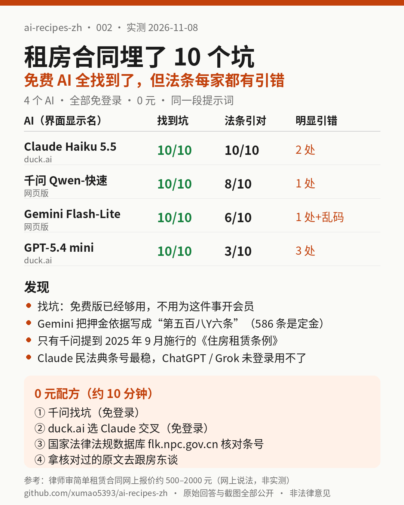

# 002｜租房合同里埋了 10 个坑：4 个免费 AI 全找到了，但法条每家都有引错

> 实测日期：2026-11-08（美东时间上午）。全部免登录、0 元。被测：Gemini（Flash-Lite）、千问（Qwen-快速）、duck.ai 里的 Claude Haiku 5.5 和 GPT-5.4 mini。ChatGPT、Grok、Copilot、智谱清言本次未登录用不了，DeepSeek、豆包、Kimi、元宝本期没跑成，都记为**本期未测**。

## 一句话结论

**找坑这件事，免费 AI 已经够用：10 个坑，4 家都点到了。但它们给的“第几条”不能直接拿去跟房东谈：4 家都至少引错一条，Gemini 还出现了“第五百八Y六条”这种乱码。最省钱的配方是：一个 AI 找坑，换一个 AI 交叉，再花 5 分钟去国家法律法规数据库核对条号。**

[合同原文](assets/002/contract.txt) · [提示词](assets/002/prompt.txt) · [答案键](assets/002/answer_key.json) · [四家原始回答](assets/002/answers/) · [截图](assets/002/screenshots/) · [评分表](assets/002/scoring.json) · [法条原文](assets/002/law/)

## 要解决的问题

签租房合同前，大多数人只看租金和押金。真正让人吃亏的是藏在后面的条款：押金到期不退、房东随时涨租、卖房就让你 7 天搬走、出了燃气事故房东不负责……

请律师审一份简单租赁合同，网上律所科普页给的参考价是 **500–2000 元**（[北京惠诚律所科普页](https://www.huichenglawyer.com/pufaku/243698.html)；[律图](https://www.64365.com/zs/7694351.aspx)写的是“几百到一千元左右”。这两条是网上说法，只作参考，不是我们测的）。

所以本期只回答一个问题：**不花钱，靠免费 AI，能不能把合同里的坑找全？哪里会出错？**

## 实测设计

1. **自己写了一份“带坑”的合同**：16 条，其中 10 条是故意埋的坑，另有几条是正常条款，用来看它会不会乱报。每个坑都对照民法典原文写了依据，见[答案键](assets/002/answer_key.json)。
2. **同一段提示词**，原样粘贴给每个 AI，新开对话、默认设置、未登录、不开深度思考或联网搜索：
   > 我准备签下面这份租房合同，我是乙方（租客）。请逐条找出对我不利、不公平或可能违法无效的条款，每条说明：1）问题是什么；2）法律依据（如果有，请写到具体法条）；3）签之前我该怎么改或者怎么谈。最后告诉我哪几条最严重。
3. **评分看两件事**：
   - **找到没有**：回答里明确指出了这一条有问题，才算找到。
   - **法条对不对**：拿它写的条号，去对照民法典和《住房租赁条例》原文（[law/](assets/002/law/)里有我们抓下来的原文和来源）。条号说的内容和它讲的不一样，就算引错。

### 10 个坑

| # | 合同条款 | 坑在哪 | 最直接的依据（已核对原文） |
|---|---|---|---|
| T1 | 第四条 | 押金到期一律不退，充当“清洁折旧费” | 民法典 710 条（正常损耗不赔）、497 条；住房租赁条例第十条 |
| T2 | 第五条 | 房东可单方涨租，不同意算你违约 | 民法典 543 条（变更合同要协商一致） |
| T3 | 第六条 | 逾期 1 天就解约、没收押金、停水停电、24 小时搬走 | 民法典 722 条（要先催告、给合理期限）；条例第十二条 |
| T4 | 第八条 | 房屋结构、管线、家电全部维修都归租客 | 民法典 712、713 条 |
| T5 | 第九条 | 房东随时进屋，不用通知 | 民法典 1032、1033 条；条例第九条（三） |
| T6 | 第十条 | 燃气、电线老化出人命，房东也不负责 | 民法典 506 条（人身损害免责条款无效）；条例第七条 |
| T7 | 第十一条 | 房子一卖，合同自动终止，7 天搬走 | 民法典 725 条（买卖不破租赁） |
| T8 | 第十二条 | 让租客放弃优先购买权、优先承租权 | 民法典 726、734 条 |
| T9 | 第十三条 | 违约金不对等：租客赔剩余全部房租，房东只退没住的 | 民法典 585 条（违约金过高可请求调减） |
| T10 | 第十五条 | 退房要“恢复全新”，正常磨损也要赔 | 民法典 710、733 条 |

> 说明：答案键初版漏了 2025 年 9 月 15 日起施行的《住房租赁条例》（国务院令第 812 号）。评分时是千问的回答提醒了我们，已对照[中国政府网原文](https://www.gov.cn/zhengce/zhengceku/202507/content_7032956.htm)补上。补入后，没有改变任何一家“找到/没找到”的判定。

## 结果

| | Gemini Flash-Lite | 千问 Qwen-快速 | Claude Haiku 5.5（duck.ai） | GPT-5.4 mini（duck.ai） |
|---|---|---|---|---|
| 10 个坑找到几个 | **10** | **10**（第六条只抓了一半） | **10** | **10** |
| 每个坑引到了对的法条 | 6 个（另 1 个半对） | 8 个（另 2 个半对） | **10 个** | 3 个（另 2 个半对） |
| 明显引错的条号 | 1 处，另有 3 处数字乱码 | 1 处 | 2 处 | 3 处 |
| 提到 2025 年《住房租赁条例》 | 没有 | **有**（第九、十条引对） | 没有 | 没有 |
| 是否需要登录 / 花钱 | 否 / 0 元 | 否 / 0 元 | 否 / 0 元 | 否 / 0 元 |

模型名都是界面上显示的名字，我们无法核实背后具体版本。

### 每家具体错在哪（原文都在 answers/ 里）

- **Gemini**：押金的依据写成“《民法典》第五百八Y六条”。不仅数字乱了，586 条讲的是**定金**，跟押金不是一回事。另外“第五百四3条”“第五百八5条”也是阿拉伯数字和汉字混在一起。[截图](assets/002/screenshots/gemini-top.png)
- **GPT-5.4 mini**：两次把 711 条说成“保管不善致损”相关，711 条其实讲的是“没按约定方法使用、房东可以解约索赔”（保管不善在 714 条）。优先承租权写成 730 条（实际在 734 条）。最可惜的是“人身伤害免责”那条：它只引了 506 条里“财产损失”的半句，漏了最关键的“造成对方人身损害的免责条款无效”。
- **Claude Haiku 5.5**：每个坑都引到了对的法条，也是唯一引对 722 条（逾期要先催告）的。但它额外补充时，把“六个月以上要书面形式”写成 706 条（实为 707 条），把 728 条讲成“无权处分”（实为妨碍优先购买权的赔偿）。
- **千问**：唯一知道 2025 年新《住房租赁条例》的，也是唯一引用 710 条“正常损耗不赔”的。但把“不得暴力、威胁逼迁”标成条例第七条，原文在第十二条。

### 我们的判断

1. **找坑这件事，免费版已经够用。** 4 家都把 10 个坑点到了，还都给出了能直接用的改写建议。本期没测付费版，所以不说付费版更好还是更差；只能说，就这件事，你不需要为了它去开会员。
2. **条号别直接甩给房东。** 4 家都有引错，而且错的方式很像真的。如果你在微信里跟房东说“根据民法典第 586 条，押金要退”，对方一查就站不住了。
3. **两家互补比一家可靠。** Claude 的民法典条号最稳；千问独家带出了 2025 年新条例。两家合起来，民法典和新条例都覆盖到了。

## 配方：0 元把一份租房合同审到“能谈”的程度

| 步骤 | 用什么 | 为什么 | 时间 |
|---|---|---|---|
| 1. 找坑 | [千问网页版](https://www.qianwen.com/)，不用登录 | 本次唯一引用 2025 年《住房租赁条例》的 | 约 2 分钟 |
| 2. 交叉 | [duck.ai](https://duck.ai/) 里选 Claude，不用登录 | 本次民法典条号最准；Claude 账号被封、注册不了的人也能用 | 约 2 分钟 |
| 3. 核对条号 | [国家法律法规数据库](https://flk.npc.gov.cn/)，搜“民法典”“住房租赁条例” | 官方原文，免费；只核对你准备拿去谈的那几条 | 约 5 分钟 |
| 4. 去谈 | 把核对过的原文和 AI 给的改写建议，一起发给房东或中介 | 原文比“AI 说的”有说服力 | — |

用的提示词就是上面那段，直接复制就能用。把合同里的个人信息（姓名、身份证号、门牌号）先删掉再粘贴。

**本期没验证的（不在配方里）**：拍照识别纸质合同的准确率、长合同（几十页）会不会漏、AI 帮你写的“谈判话术”房东接不接受。

## 谁不用花钱，谁该花钱

- **不用花钱**：普通住宅、个人房东、一年左右的租约。按上面的配方，0 元，10 分钟左右。和律师审合同 500–2000 元的参考价相比（这个价格是网上说法，见上文出处），这一步完全可以自己做。
- **该找人**：房东拒绝修改而你又非签不可；押金加预付租金金额很大；房子要用来注册公司、经营；已经发生纠纷。这时 AI 的结论只能当“问题清单”，带着它去找律师或当地公共法律服务（12348 热线），能少花咨询时间。

## 本期没测到的

ChatGPT、Grok 未登录发送后被要求登录（[截图](assets/002/screenshots/chatgpt-login-wall.png)、[截图](assets/002/screenshots/grok-login-wall.png)）；Copilot 跳转微软登录；智谱清言需要微信或手机验证码（[截图](assets/002/screenshots/zhipu-login-wall.png)）；DeepSeek、豆包、Kimi、元宝本期没拿到回答。这些都**没测**，不在上面的结论里。之后用免费账号补测，会在这里更新。

## 复现

1. 打开 [prompt.txt](assets/002/prompt.txt)，整段复制；
2. 在任何一个 AI 里新开对话粘贴；
3. 对照 [answer_key.json](assets/002/answer_key.json) 数它找到几个坑，再把它写的条号拿去 [law/](assets/002/law/) 或国家法律法规数据库核对。

欢迎把你测到的结果（工具、日期、截图）发到 Issue。

*本文不是法律意见。具体纠纷请咨询律师。*
