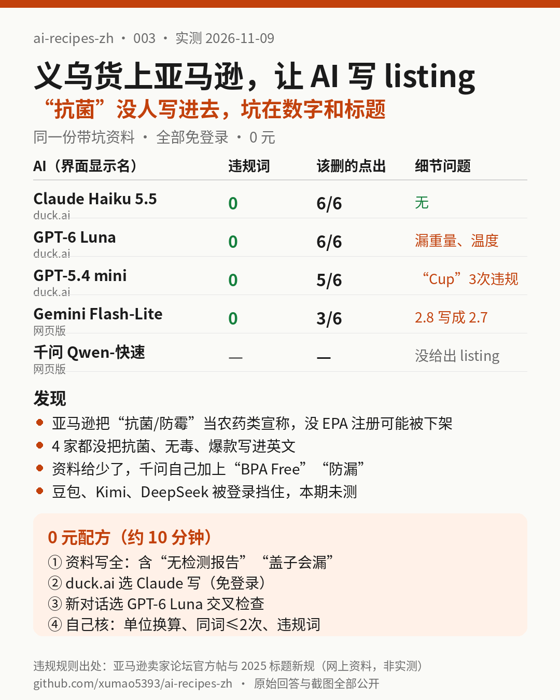

# 003｜义乌拿货上亚马逊：让 AI 写英文 listing，谁会把“抗菌”写进去害你被下架？

> 实测日期：2026-11-09（美东时间上午）。全部免登录、0 元。实测：Gemini（Flash-Lite）、duck.ai 里的 Claude Haiku 5.5、GPT-5.4 mini、GPT-6 Luna，以及千问（Qwen-快速）。豆包、Kimi、DeepSeek 被登录或地区限制挡住，智谱 Z.ai 一直卡在“思考中”，这些都记为**本期未测**。

## 一句话结论

**4 个给出答案的 AI，没有一个把“抗菌、环保无毒、全网爆款”写进英文 listing，这一关免费版都能过。真正的差距在细节：漏写重量、温度，单位换算错，标题违反亚马逊 2025 年“同一个词最多两次”的新规。本次最完整的是 duck.ai 里的 Claude Haiku 5.5，0 处问题。另一个坑更值得注意：资料给得太少时，千问会自己补上“BPA Free”“Leakproof（防漏）”这种资料里根本没有的卖点。**

[产品资料](assets/003/spec.txt) · [提示词](assets/003/prompt.txt) · [答案键](assets/003/answer_key.json) · [原始回答](assets/003/answers/) · [截图](assets/003/screenshots/) · [页面 PDF](assets/003/pdf/) · [评分表](assets/003/scoring.json) · [自动预检脚本](assets/003/score.py)

## 要解决的问题

在义乌、1688 拿货做亚马逊，最费时间的一步是写英文 listing。很多人直接把供货商的中文宣传语丢给 AI 翻译。问题是，供货商最爱写的那几个词，在亚马逊美国站恰恰是雷：

- **“抗菌、防霉”**：亚马逊把 antibacterial、antimicrobial、anti-mold 这类说法当作“农药类宣称”，按美国环保署（EPA）的规定，没有 EPA 注册号就可能被下架。出处见下文“网上资料”。
- **“环保无毒”**：eco-friendly、non-toxic 这类说法需要有依据（美国联邦贸易委员会 FTC 的《绿色指南》）。
- **“全网爆款”**：亚马逊标题规范明确不让写“Best seller”“Hot Item”这类主观评价。

所以本期只回答一个问题：**把一份带坑的真实格式资料交给免费 AI，它写出来的 listing 能不能直接上架？哪里会出错？**

## 实测设计

1. **一份按义乌供货商常见格式写的产品资料**（[spec.txt](assets/003/spec.txt)）：硅胶折叠水杯，500ml，120g，杯身耐温 -40～230℃，**杯盖只耐 100℃，不能进微波炉，按扣盖倒过来会漏水，供货商没有任何检测报告**，最后附上一句原样的宣传语：“抗菌防霉，环保无毒，防摔耐用，户外露营旅行必备，全网爆款”。
2. **同一段提示词**（[prompt.txt](assets/003/prompt.txt)）：要求写标题（≤200 字符）、5 条卖点、描述、后台搜索词（≤249 字节），只能用资料里的信息，并换算成美国单位；最后用中文说出哪些说法不能直接用。每个 AI 都是新开对话、默认模型、未登录、不开深度思考和联网搜索。
3. **评分看四件事**（细则见[答案键](assets/003/answer_key.json)）：
   - 英文 listing 里有没有写进违规或没有依据的说法（抗菌、无毒、环保、FDA/BPA/认证、防漏、微波炉可用、热销第一）；
   - 有没有编造资料外的参数；
   - 8 个数字的美国单位换算对不对、写全没有（16.9 fl oz、4.2 oz、-40°F～446°F、杯盖 212°F、5.9 in、1.8 in、2.8 in）；
   - 中文部分点出了几个该删的说法（6 个：抗菌防霉、环保无毒、防摔耐用、必备、全网爆款、“食品级”需要文件证明）。

先用 [score.py](assets/003/score.py) 做关键词预检（结果在 [scoring_auto.json](assets/003/scoring_auto.json)），再逐句人工核对上下文。比如“not microwave safe”命中了“microwave”，人工确认是正确的警示，不算违规。

## 结果

| | Claude Haiku 5.5（duck.ai） | GPT-6 Luna（duck.ai） | GPT-5.4 mini（duck.ai） | Gemini Flash-Lite | 千问 Qwen-快速 |
|---|---|---|---|---|---|
| 给出 listing | 是 | 是 | 是 | 是 | **否**（拒答 1 次，另 2 次只弹登录提示） |
| 英文里写进违规说法 | 0 | 0 | 0 | 0 | — |
| 编造资料外参数 | 0 | 0 | 0 | 0 | — |
| 单位换算 | **全对、全写** | 没写重量；**温度一个都没写进 listing**，中文里却说“已换算” | 没写重量和杯口直径 | 杯口 7cm 写成 2.7 in（应为 2.8） | — |
| 标题合规（≤200 字符、同词≤2 次） | 151 字符，合规 | 127 字符，合规 | 160 字符，**“Cup”出现 3 次，违反新规** | 171 字符，合规；但把杯子叫成“Water Bottle” | — |
| 中文点出该删的说法 | **6/6**，并点名 EPA、FTC | **6/6** | 5/6（“食品级”没提，反而写进了标题） | 3/6（漏了防摔耐用、必备、食品级） | — |
| 是否登录 / 花钱 | 否 / 0 元 | 否 / 0 元 | 否 / 0 元 | 否 / 0 元 | 否 / 0 元 |

模型名都是界面上显示的名字，我们无法核实背后具体版本。逐项记录在[评分表](assets/003/scoring.json)。

### 千问这次怎么了

- 第一次发完整提示词，回答只有一句：“你好，我无法回答这个问题，我们换一个话题聊聊吧。”（[截图](assets/003/screenshots/qianwen-1.png)）
- 新开对话重发一遍，以及去掉最后那句合规问题再发，两次都没出回答，只显示“登录后畅享完整功能->”（[截图](assets/003/screenshots/qianwen-retryA-1.png)、[截图](assets/003/screenshots/qianwen-B-1.png)）。
- 我们**不知道**它为什么拒答，也没有登录后再测。只能说：未登录的千问网页版，今天跑不了这个任务。上一期（002）同样未登录的千问回答了一份 16 条的租房合同，这次为什么不行，本期没查清。

### 附加测试：资料给少了会怎样（和上表不可比）

我们另外只给千问发了一句话：“帮我把‘硅胶折叠水杯，500ml，带挂扣’写成亚马逊美国站的英文标题”。它答了（[原文](assets/003/answers/qianwen-short.txt)、[截图](assets/003/screenshots/qianwen-short-1.png)），3 个标题全都把杯子叫成“Water Bottle”，其中两个加了 **“BPA Free”**，一个加了 **“Leakproof”（防漏）**，还说这是“买家非常关注的属性”。

这两点资料里都没有。而按我们那份完整资料，这个杯子没有任何检测报告，杯盖倒过来还会漏。**这不是千问一家的问题：只要你给的信息少，AI 就会用“同类商品常见卖点”去补。** 这一条只是一次单独测试，提示词和上面的不同，不拿来给千问打分。

## 我们的判断

1. **“抗菌”这类雷，免费 AI 已经会躲。** 前提是你把供货商原话和“没有检测报告”这件事一起告诉它。4 家都没把它写进英文。
2. **真正要人工看的是数字和标题。** 4 家里有 3 家在单位、漏项或标题规则上出了问题，而且错得不显眼：2.7 in 和 2.8 in 只差一点，“Cup”出现 3 次也不容易看出来。
3. **资料越全，AI 越老实（本期只有一次对照）。** 把“没有检测报告”“盖子会漏”这种对自己不利的信息也写进去，它才不会替你编“防漏”“BPA Free”。

## 配方：0 元把供货商资料变成能上架的英文 listing

| 步骤 | 用什么 | 为什么 | 时间 |
|---|---|---|---|
| 1. 整理资料 | 照 [spec.txt](assets/003/spec.txt) 的格式，把参数、使用限制、**有没有检测报告**、供货商原话都写上 | 资料里没写的，AI 会自己补 | 约 5 分钟 |
| 2. 写 listing | [duck.ai](https://duck.ai/) 选 Claude，不用登录，粘贴 [prompt.txt](assets/003/prompt.txt) 的格式 | 本次唯一一个换算全对、写全、标题合规的 | 约 1 分钟 |
| 3. 交叉检查 | 同一个 duck.ai 新开对话，选 GPT-6 Luna，发同样内容 | 本次合规提醒也是 6/6，而且主动把“食品级”拿掉了，适合当第二意见 | 约 1 分钟 |
| 4. 人工核三样 | 自己数标题里有没有词出现 3 次；用搜索引擎换算 ml→fl oz、g→oz、℃→℉；确认英文里没有 antibacterial、non-toxic、eco-friendly、FDA、BPA free、leakproof、best seller | 这三样本次都有 AI 出错 | 约 5 分钟 |

**本期没验证的（不在配方里）**：A+ 页面和图片上的文字、亚马逊后台真实提交是否通过、这些 listing 的搜索排名和转化率、儿童用品和电器这类有额外合规要求的品类。

## 谁不用花钱，谁该花钱

- **不用花钱**：手上几个、十几个普通家居小商品，按上面的配方，一个 listing 大约 10 分钟，0 元。
- **本期没测、所以不下结论**：Helium 10 这类付费 listing 工具，以及请人代写。我们没有测它们，也就不说它们值不值。
- **该找专业的人**：资料里出现抗菌、防蚊、净化、儿童、食品接触这类说法，而且你真的想保留这个卖点。这时要的是 EPA 注册或检测报告，不是更好的文案，AI 帮不上。

## 网上资料（只作参考，不是我们测的）

- 亚马逊卖家论坛的官方帖子说明：宣称 antimicrobial、antibacterial、anti-mold 等功效的商品，可能被视为美国 EPA 管理的农药或农药器械，需要 EPA 注册号，或把这些说法从标题、卖点、描述、图片和包装上去掉。见 [Restricted Product Scenarios: Pesticides](https://sellercentral.amazon.com/seller-forums/discussions/t/ea725b4a-9974-4c53-b67a-2fad1137f80e)、[Listings Lounge: Demystifying Pesticides and Pesticide Devices](https://sellercentral.amazon.com/seller-forums/discussions/t/39f61eb3-cbbe-4273-b15f-087bc1a5b511)。
- 2025 年 1 月 21 日起的标题新规：多数品类不超过 200 字符（含空格），不能用 ! $ ? _ { } ^ ¬ ¦，同一个词最多出现两次（介词、冠词、连词除外，单复数算同一个词），不要用“Best seller”“Hot Item”等主观评价。见[亚马逊全球开店公告](https://gs.amazon.cn/news/news-notices-250120)、[卖家论坛公告](https://sellercentral.amazon.com/seller-forums/discussions/t/533f9cf7-3b5e-4974-b523-02e4a1a42c5f)。
- 环保类宣称的依据要求：美国 FTC《绿色指南》，[16 CFR Part 260](https://www.ecfr.gov/current/title-16/chapter-I/subchapter-B/part-260)。

## 本期没测到的

- **豆包**：从我们的测试环境打开，跳到地区限制页“受区域限制，请先登录再使用豆包”。
- **Kimi**：发送后弹出登录框（微信扫码或手机验证码）。
- **DeepSeek**：直接跳到登录页。
- **智谱 Z.ai（GLM-5.3-Flash）**：允许游客发送，但超过 4 分钟一直显示“Thinking…”，没有回答。

记录在 [answers/](assets/003/answers/) 里文件名带 `-blocked` 的文件中。这些都**没测**，不在上面的结论里。之后用免费账号补测，会在这里更新。

## 复现

1. 打开 [prompt.txt](assets/003/prompt.txt)，整段复制到任意 AI 的新对话里；
2. 对照 [answer_key.json](assets/003/answer_key.json) 检查违规说法、单位和标题；
3. 想自动预检，把回答存成 `answers/<名字>.txt`（格式同本目录），运行 `python3 score.py`。

欢迎把你测到的结果（工具、日期、截图）发到 Issue。

*本文不是法律或合规意见。上架前以亚马逊卖家后台的最新规定为准。*
