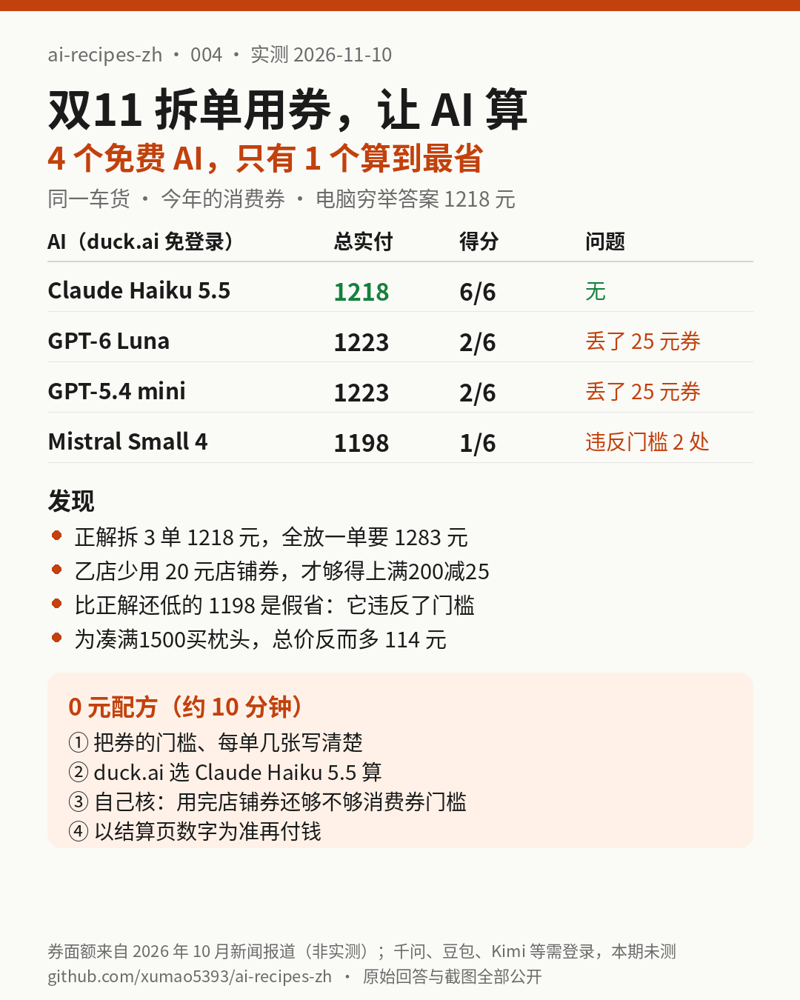

# 004｜双11 没有跨店满减了：让 AI 帮你拆单用券，4 个免费 AI 只有 1 个算到最省

> 实测日期：2026-11-10（美东时间上午）。全部在 duck.ai 免登录、0 元完成，实测 4 个模型：Claude Haiku 5.5、GPT-6 Luna、GPT-5.4 mini、Mistral Small 4。千问、Kimi、元宝、DeepSeek 一发送就要求登录，豆包显示地区限制，智谱 Z.ai 访客模式“思考”4 分半没出字，这些都记为**本期未测**。Gemini 在我们的浏览器里是已登录的付费账号，和“免登录”口径不一致，也**没有测**。

## 一句话结论

**同一车货、同一套券，正确答案是拆 3 单、实付 1218 元（全放一单要 1283 元）。只有 Claude Haiku 5.5 算对了。两个 GPT 都给出 1223 元：它们把乙店的“满200减20”用掉了，订单金额从 218 掉到 198，结果够不上“满200减25”，白丢 25 元消费券。Mistral Small 4 报了个更低的 1198 元，但那是它把 198 元当成够了 200 元的门槛，照它下单，结算页会比它说的多 25 元。四家都说不该为凑“满1500减180”去买记忆枕，这一点免费版都靠得住。**

[购物车和规则](assets/004/spec.txt) · [提示词](assets/004/prompt.txt) · [标准答案](assets/004/answer_key.json) · [穷举脚本](assets/004/bf3.py) · [原始回答](assets/004/answers/) · [截图](assets/004/screenshots/) · [页面 PDF](assets/004/pdf/) · [评分表](assets/004/scoring.json) · [自动预检](assets/004/score.py)

## 要解决的问题

今年天猫双11取消了跨店满减，商品页直接显示立减后的价格，再叠店铺券和平台消费券（出处见文末“网上资料”）。“凑单”好像不用算了，但新的坑换了个地方：

- **平台消费券一个订单只能用一张。** 一车货放一单，只能吃一张券；拆成几单，就能多用几张。
- **消费券的门槛按用完店铺券之后的金额算。** 店铺券先减，金额可能刚好掉到下一张消费券的门槛下面。
- **大额券诱惑你凑单。** 差几十块到“满1500减180”，要不要再买一件？

这种题人算很烦，看起来正好交给 AI。本期只问一件事：**把购物车和券的规则原样丢给免费 AI，它给的下单方案能不能直接照着付钱？**

## 实测设计

1. **一车 7 件货、3 家店**（[spec.txt](assets/004/spec.txt)），价格已是立减后：甲店 587 元、乙店 218 元、丙店 648 元，合计 1453 元；另有一个“有点想要”的记忆枕 169 元。店铺券：甲满500减40、乙满200减20、丙满600减50。平台消费券用的是今年新闻报道里的那套 7 张面额：满200减25×1、满480减60×2、满1500减180×2、满3000减400×1、满5000减650×1，每单最多 1 张。商品和店铺券是我们编的示例，不是哪家店的真实价格。
2. **标准答案用电脑穷举出来**，不靠人脑：[bf3.py](assets/004/bf3.py) 把 7 件货所有 877 种拆单方式（加上记忆枕是 4140 种）都试一遍，每种再试所有用券组合，包括“这张券不用”。最低价只有一种拆法：1218 元。结果在 [answer_key.json](assets/004/answer_key.json) 和 [bf_out.json](assets/004/bf_out.json)。
3. **同一段提示词**（[prompt.txt](assets/004/prompt.txt)），每个模型新开对话，用 duck.ai 免登录的 Free 档、Fast 模式，不开搜索、不开思考。回答用 duck.ai 自带的“导出对话”下载，原文一字没改。
4. **评分 6 项**：拆单方式对不对、有没有发现乙店券不该用、总价 1218 对不对、一单 1283 和省 65 对不对、记忆枕的结论和金额、有没有违反规则或算错。先用 [score.py](assets/004/score.py) 查关键数字，再逐句人工核对（[scoring.json](assets/004/scoring.json)）。

## 正确答案长什么样

| 订单 | 商品 | 金额 | 店铺券 | 消费券 | 实付 |
|---|---|---|---|---|---|
| 1 | 甲店 3 件 | 587 | 满500减40 → 547 | 满480减60 | 487 |
| 2 | 乙店 2 件 | 218 | **不用**（用了只剩 198） | 满200减25 | 193 |
| 3 | 丙店 2 件 | 648 | 满600减50 → 598 | 满480减60 | 538 |
| 合计 | | 1453 | | | **1218** |

全放一单：1453 减三张店铺券是 1343，只够用一张满480减60，实付 1283。拆单省 65 元。

关键就在第 2 单：**少用一张 20 元的券，反而多拿一张 25 元的券。** 结算页通常会自动帮你选券，它会不会这样“放弃”一张店铺券，我们没有淘宝账号可测，**本期未测**。

## 结果

| | Claude Haiku 5.5 | GPT-6 Luna | GPT-5.4 mini | Mistral Small 4 |
|---|---|---|---|---|
| 给的总实付 | **1218（对）** | 1223 | 1223 | 1198（不可能） |
| 拆成几单 | 3 单，按店拆 | 2 单（甲+乙 / 丙） | 2 单（甲 / 乙+丙） | 3 单，按店拆 |
| 发现乙店券不该用 | **是** | 否 | 否 | 否 |
| 一单 1283、省 65 | 都对 | 1283 对，省 60 | 1283 对，省 60 | 说一单是 1223（一单里用了两张券） |
| 记忆枕 | 不买；1332，多 114 | 不买；1332，多 109 | 不买；1332，多 109 | 不买，但算法错 |
| 违反规则 | 0 | 0 | 0 | **2 处** |
| 得分 | **6/6** | 2/6 | 2/6 | 1/6 |
| 登录 / 花钱 | 否 / 0 元 | 否 / 0 元 | 否 / 0 元 | 否 / 0 元 |

模型名是 duck.ai 界面上显示的名字，背后的具体版本我们无法核实。

### 几个值得看的细节

- **两个 GPT 不是算错，是没想到。** 它们每一步的加减都对，只是默认“有券就用”。GPT-6 Luna 的导出文件里带着一段界面隐藏的思考，里面出现过“1343 减 145 等于 1198”，它自己觉得不对，最后没采用（[原文](assets/004/answers/duckai-gpt6luna.txt)）。
- **Mistral 的答案最危险。** 它的 1198 比正确答案还低，看起来最省。但它让乙店 198 元的订单用“满200减25”，这张券根本用不了；它算“一单结算”时还一单用了两张满480减60。照它的方案付钱，第 2 单结算页会是 198，不是它说的 173（[截图](assets/004/screenshots/duckai-other-2.png)）。**AI 给的数字比别人低，不代表更省，可能只是它违反了规则。**
- **记忆枕这题都没翻车。** 买了枕头一单实付 1332，比最优的 1218 多 114 元，相当于花 114 元买一个 169 元的枕头。本来就想要可以买，但这不叫“省钱”。四家都答了“不买”。

## 0 元配方（约 10 分钟）

1. **把规则抄全**：每张券的门槛按什么算（按标价、还是按用完店铺券之后）、每单能用几张、能不能拆同一家店。我们这次的写法可以直接套：[spec.txt](assets/004/spec.txt)。
2. **duck.ai 选 Claude Haiku 5.5 算**，免登录。本期只有它算出最优。
3. **自己核一件事**：每一单用完店铺券后的金额，是不是还够得上它用的那张消费券。这一步抓住了本期所有的错。
4. **想再保险，新开对话问另一个模型**：“有没有哪张店铺券不用反而更省？”这句话我们没有实测，只是根据本期的错误给出的建议。
5. **付钱前看结算页**：结算页显示的数字才算数。

**谁不用付钱**：本期这种题，免费的 Claude Haiku 5.5 已经算对了。买付费会员不会让你在双11多省钱；把规则写清楚、自己核那一步更有用。付费版是否算得更好，本期没有测。

## 网上资料（只作背景，不是我们的实测）

- 天猫今年取消跨店满减，改为商家立减加平台消费券：[东方财富网，2026-10-15](https://finance.eastmoney.com/a/202610153897295383.html)
- 记者在淘宝 App 看到的消费券面额（200-25、480-60×2、1500-180×2、3000-400、5000-650）：[中国金融新闻网，转载于腾讯新闻，2026-10-16](https://news.qq.com/rain/a/20261016A0D28000)
- 先算店铺优惠再看消费券档位、每单一张消费券、膨胀只能一次：[什么值得买](https://post.smzdm.com/p/a7049deo/)

这些是别人的报道，我们没有在淘宝 App 里核对。本期题目里的券面额照搬了报道，商品和店铺券是示例。“膨胀券”规则太复杂，本期没有放进题目。

## 本期没测到、留给以后

- 千问、Kimi、元宝、DeepSeek、豆包、智谱：需要登录（或地区限制、或卡住），登录后再测同一道题。证据：[截图](assets/004/screenshots/)。
- Gemini 免登录版、各家付费版。
- 淘宝结算页自动选券会不会主动放弃一张店铺券。
