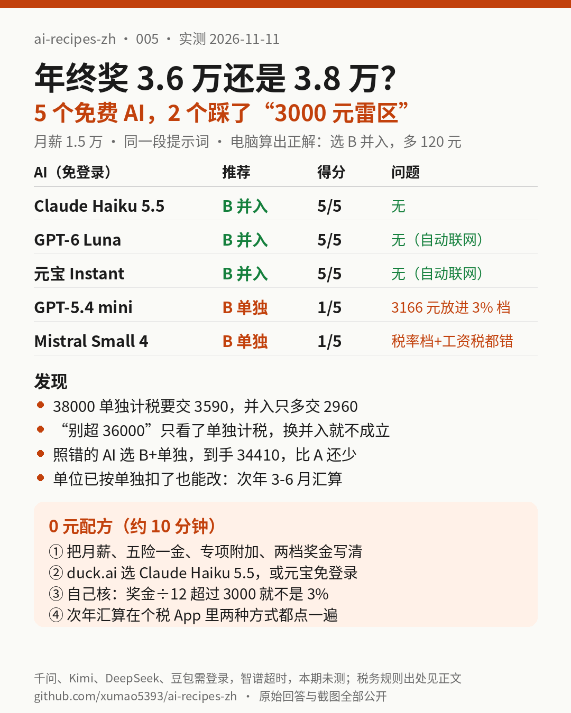

# 005｜年终奖 3.6 万还是 3.8 万？5 个免费 AI 帮你算，2 个踩了“3000 元雷区”

> 实测日期：2026-11-11（美东时间上午）。全部免登录、0 元完成，实测 5 个：duck.ai 上的 Claude Haiku 5.5、GPT-6 Luna、GPT-5.4 mini、Mistral Small 4，以及腾讯元宝（访客模式，默认 Instant）。千问、Kimi 点发送就要求登录；智谱 Z.ai（GLM-5.3-Flash）访客模式转了约 4 分钟没出字；DeepSeek、豆包需要登录（豆包还显示地区限制），这两家本期没留下当天截图。以上都记为**本期未测**。Gemini 在我们的浏览器里是已登录的付费账号，和“免登录”口径不一致，也**没有测**。

## 一句话结论

**月薪 1.5 万、五险一金 3000、专项附加 5000 的人，HR 让你在 36000 和 38000 年终奖里二选一：正确答案是选 38000、并入综合所得，比 36000 多到手 120 元。Claude Haiku 5.5、GPT-6 Luna、元宝都算对了。GPT-5.4 mini 和 Mistral Small 4 把 38000÷12=3166.67 放进了 3% 档（月度表 3% 只到 3000），算出“选 38000 单独计税多到手 1940 / 4340 元”。照它们做，实际到手 34410 元，比最优少 630 元，比直接拿 36000 还少 510 元。**

[提示词](assets/005/prompt.txt) · [计算脚本](assets/005/calc.py) · [标准答案](assets/005/answer_key.json) · [原始回答](assets/005/answers/) · [截图](assets/005/screenshots/) · [页面 PDF](assets/005/pdf/) · [评分表](assets/005/scoring.json) · [自动预检](assets/005/score.py)

## 要解决的问题

年底很多公司会定年终奖。网上流传最广的一条经验是“年终奖别刚好超过 36000，多发 1 块钱要多交两千多的税”。这句话**只在单独计税时成立**：年终奖单独计税时除以 12 查月度税率表，3000 元以内 3%，超过就整笔按 10% 再减 210。

但单独计税只是二选一里的一种。另一种是并入当年综合所得，和工资一起按年度税率表算。两种怎么选、选完到手多少，要把自己的工资和扣除放进去才算得出来。

这种账很适合丢给 AI，前提是它别把税率档看错。本期只问一件事：**把工资、扣除和两档年终奖原样给免费 AI，它的建议能不能直接拿去回复 HR？**

## 实测设计

1. **一个具体的人**（[prompt.txt](assets/005/prompt.txt)）：2026 年只有一份工作，月薪税前 15000，五险一金个人部分每月 3000，专项附加扣除每月 5000，12 月发年终奖，方案 A 36000、方案 B 38000。这是我们编的示例，不是真人工资。
2. **标准答案用脚本算**（[calc.py](assets/005/calc.py)），税率表来自税务总局公布的年度综合所得税率表和按月换算税率表。四个组合都算一遍，结果在 [answer_key.json](assets/005/answer_key.json)。
3. **同一段提示词**，每个模型新开对话、默认设置。duck.ai 用免登录 Free 档、Fast 模式，没有手动打开搜索或思考。GPT-6 Luna 和元宝回答时**自己联网搜索**了，我们没有去开，这一点在下表里标出来。duck.ai 的回答用它自带的“导出对话”下载，原文没改。元宝没有导出功能，回答以截图为准，[transcript](assets/005/answers/yuanbao.transcript.txt) 是照着页面整理的文字版。
4. **评分 5 项**：四个组合的税额、每个方案选哪种算法、最终选哪个和多多少、单位已按单独计税扣了还能不能改、有没有算错税率档。先用 [score.py](assets/005/score.py) 查关键数字，再逐句人工核对（[scoring.json](assets/005/scoring.json)）。

## 正确答案长什么样

工资部分：180000 − 60000（基本减除）− 36000（五险一金）− 60000（专项附加）= 24000，按 3% 交 720 元。

| 方案 | 计税方式 | 年终奖这部分的税 | 全年个税合计 | 年终奖到手 |
|---|---|---|---|---|
| A 36000 | **单独计税** | 36000÷12=3000 → 3%，1080 | **1800** | **34920** |
| A 36000 | 并入综合所得 | 3480−720=2760 | 3480 | 33240 |
| B 38000 | 单独计税 | 38000÷12=3166.67 → 10%−210，3590 | 4310 | 34410 |
| B 38000 | **并入综合所得** | 62000×10%−2520=3680，减去 720 = 2960 | **3680** | **35040** |

**选 B、并入综合所得，比 A 的最优做法多到手 120 元。** 多发的 2000 元里有 1880 元交了税，但总账还是 B 多。

所以“别超 36000”这条经验在这里只对了一半：**超过了，换并入综合所得就行。** 反过来，如果你一定要单独计税，36000 才是更好的那档。

## 结果

| | Claude Haiku 5.5 | GPT-6 Luna | 元宝 Instant | GPT-5.4 mini | Mistral Small 4 |
|---|---|---|---|---|---|
| A 单独 / 并入 | 1800 / 3480 ✅ | 1800 / 3480 ✅ | 1800 / 3480 ✅ | 1800 / 3480 ✅ | **3600** / 3480 |
| B 单独 / 并入 | 4310 / 3680 ✅ | 4310 / 3680 ✅ | 4310 / 3680 ✅ | **1860** / 3680 | **3660** / 3680 |
| 推荐 | **B + 并入，多 120** | **B + 并入，多 120** | **B + 并入，多 120** | B + 单独，“多 1940” | B + 单独，“多 4340” |
| 已扣了能不能改 | 能，次年 3/1–6/30 汇算 | 能，App 里“奖金计税方式选择” | 能，并提醒单位报错项目时要找 HR 更正 | 能，次年 3/1–6/30 汇算 | 能，次年 3/1–6/30 汇算 |
| 得分 | **5/5** | **5/5** | **5/5** | 1/5 | 1/5 |
| 联网搜索 | 没有 | 自动搜了 | 自动搜了 | 没有 | 没有 |
| 登录 / 花钱 | 否 / 0 元 | 否 / 0 元 | 否 / 0 元 | 否 / 0 元 | 否 / 0 元 |

模型名是界面上显示的名字，背后的具体版本我们无法核实。

### 几个值得看的细节

- **错的两家，错在同一个地方。** GPT-5.4 mini 写的是“38000 ÷ 12 = 3166.67，对应月度税率表 3% 档”（[原文](assets/005/answers/duckai-gpt54-mini.export.txt)）。月度表 3% 只到 3000 元，3166.67 已经是 10% 档。Mistral 犯了同一个错，还把工资税按“每月 7000×3%”算成 2520，漏了每月 5000 的基本减除费用，所以连 A 都推荐成了更贵的并入（[原文](assets/005/answers/duckai-mistral-small4.export.txt)）。
- **结论“选 B”碰巧对，但照着做会亏。** 这两家都说选 B，只是理由错了：它们让你选 B + 单独计税。照这样，B 实际到手 34410，比正确做法少 630 元，比 A 还少 510 元。**只看“选哪个方案”对不对不够，要看它让你用哪种算法。**
- **对的三家里，两家自己联网了。** GPT-6 Luna 和元宝回答时都去搜了税务局的说明，并给了出处。Claude Haiku 5.5 没有联网，也算对了。所以本期不能说“联网一定更准”，只能说三家都对。
- **第 4 问五家都答对了**，说法和税务局公开答复一致（见文末）：单位发奖金时按单独计税扣了，次年 3 月 1 日到 6 月 30 日年度汇算时可以在个税 App 里改成并入。元宝还多提醒了一句：如果单位预扣时没按“全年一次性奖金”项目申报，App 里可能看不到切换入口，要让单位更正申报。这句和深圳市税务局的答复相符。

## 0 元配方（约 10 分钟）

1. **把数字写全**：月薪、五险一金个人部分、专项附加扣除合计、两档奖金，还有“全年有没有别的收入”。可以直接套我们的 [prompt.txt](assets/005/prompt.txt)。
2. **用 duck.ai 的 Claude Haiku 5.5，或者元宝**，都不用登录。本期这两家没联网、联网各一家，都算对。
3. **自己核一件事**：年终奖除以 12，超过 3000 就不是 3% 档，超过 12000 就不是 10% 档。本期两家的错都出在这里。
4. **年终奖的税，12 月不是最后结果。** 单位扣完以后，次年 3 到 6 月汇算时在个税 App 里把两种方式都选一遍，看哪个应纳税额低。这一步我们没有个税 App 账号可测，**本期未测**，操作路径来自税务部门的公开说明。
5. **回复 HR 之前**：如果你的情况和示例不同（比如有劳务费、稿酬，或者一年有两笔奖金），重新问一遍，别直接套本期数字。

**谁不用付钱**：这种题，免费的 Claude Haiku 5.5、GPT-6 Luna、元宝都算对了，不需要为这种账开会员。个税 App 汇算时本身也会算出两种方式的税额（税务部门的说法，我们没测）。付费版 AI 会不会更准，本期没有测。

## 网上资料（只作背景，不是我们的实测）

- 全年一次性奖金可以单独计税，也可以并入综合所得，政策执行至 2027 年 12 月 31 日：[财政部 税务总局公告 2023 年第 30 号](https://fgk.chinatax.gov.cn/zcfgk/c102416/c5211524/content.html)；[青岛市 12366 答复，2026-03-24](https://12366.chinatax.gov.cn/nszx/onlinemessage/detail?id=417b1cf6de1d48efb4a801f2ce548ff7)
- 已按单独计税的，汇算时可以重新选择；一年内单独计税只能用一次：[国家税务总局广西区税务局](https://guangxi.chinatax.gov.cn/nsfw/nszx/rdwd/202501/t20250108_411562.html)
- 单位预扣时没有单独申报全年一次性奖金的，汇算时无法从工资里拆出来，需要单位更正预缴申报：[国家税务总局深圳市税务局](https://shenzhen.chinatax.gov.cn/sztax/zcwj/rdwd/202503/40640356269947b18ee768469560b214.shtml)
- 个税 App 里“奖金计税方式选择”的操作步骤：[澎湃新闻·政务号转载的税务部门说明](https://www.thepaper.cn/newsDetail_forward_27874654)

这些是官方和媒体的说明，我们没有在个税 App 里实际操作。本期的工资和奖金是示例数字。
