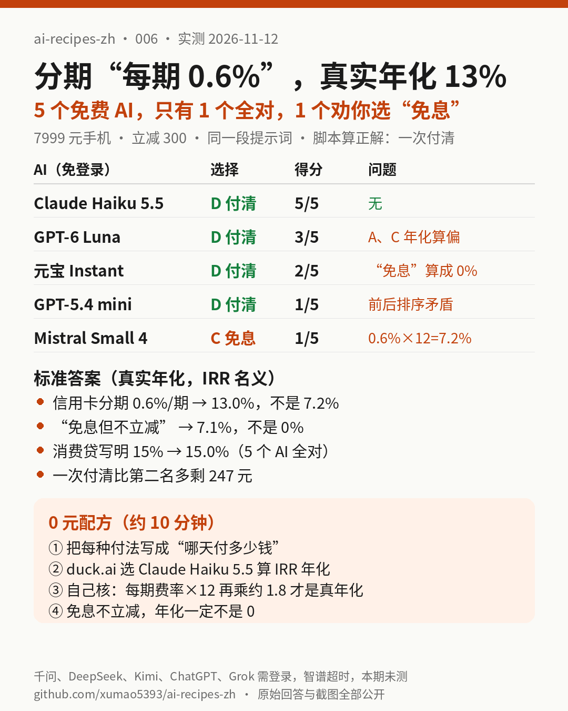

# 006｜手机分期“每期 0.6%”，真实年化是 13%：5 个免费 AI 帮你算，只有 1 个全对，1 个劝你选“免息”

> 实测日期：2026-11-12（美东时间上午）。全部免登录、0 元完成，实测 5 个：duck.ai 上的 Claude Haiku 5.5、GPT-6 Luna、GPT-5.4 mini、Mistral Small 4，以及腾讯元宝（访客模式，默认 Instant）。千问、DeepSeek、Kimi、ChatGPT（未登录）、Grok（未登录）点发送就要求登录；智谱 Z.ai（GLM-5.3-Flash）访客模式思考约 4.5 分钟仍没出字。以上都记为**本期未测**，登录墙截图在 [screenshots/](assets/006/screenshots/)。豆包本期没有尝试。

## 一句话结论

**手上有闲钱放在货币基金（年化 1.3%）的人，买 7999 元的手机：一次付清拿立减 300 元最省；“12 期免息但不立减”看着 0 利息，真实年化其实是 7.1%；信用卡分期“每期 0.6%”真实年化 13.0%，比很多人以为的 7.2% 高出将近一倍。5 个免费 AI 里只有 Claude Haiku 5.5 五项全对；Mistral Small 4 把信用卡分期算成 7.2%、把“免息”算成 0%，最后劝你选免息，照它做比最优多花约 247 元。**

[提示词](assets/006/prompt.txt) · [计算脚本](assets/006/calc.py) · [标准答案](assets/006/answer_key.json) · [原始回答](assets/006/answers/) · [截图](assets/006/screenshots/) · [评分表](assets/006/scoring.json)

## 要解决的问题

双 11 前后买手机、电脑，结账页会同时摆出好几种付法：一次付清立减、信用卡账单分期、消费贷、商家“免息”。页面上写的是“每期 0.6%”“年化 15%”“0 利息”，三种说法口径都不一样，放在一起根本没法直接比。

把条件原样交给 AI 算，是普通人最顺手的做法。本期只问一件事：**免费 AI 给出的排序和金额，能不能直接拿来决定怎么付钱？**

## 先把一个词说清楚：真实年化（IRR）

IRR 叫“内部收益率”，大白话是：**把你每个月实际掏的钱和你实际借到手的钱对上，倒推出一个“如果按银行存款那样算，年利率是多少”。** 它看的是你**真正占用了多少钱、占用了多久**。

- 信用卡分期“每期 0.6%”是按**最初全部本金**每月收费，但你的本金每个月都在还，后半年其实只欠一点点，手续费却一分不少。所以它不是 7.2%，而是约 13.0%。
- 商家“免息但不立减”：你等于用 300 元的立减，换来“晚一点付钱”的权利。这 300 元就是利息，折成年化约 7.1%。

中国人民银行公告〔2021〕第 3 号要求所有贷款产品在营销时以明显方式展示年化利率，分期手续费也要算进贷款成本，并且按**每期还款后的剩余本金**计算实际占用（[人民银行原文](https://www.pbc.gov.cn/goutongjiaoliu/113456/113469/2025092212551432728/index.html)，[中国政府网转载](https://www.gov.cn/zhengce/zhengceku/2021-03/31/content_5597156.htm)）。这是引用的外部规定，不是我们的测试结果；我们的计算脚本复现了公告附件里的示例（单利口径 12.80%、IRR 口径 13.58%，两个数都对上），用来确认算法和官方一致。

## 实测设计

1. **一个具体的场景**（[prompt.txt](assets/006/prompt.txt)）：手机标价 7999，一次付清立减 300（7699）。A 信用卡账单分期 12 期，每期 0.6%；B 消费贷 12 期等额本息，年化 15%；C 商家 12 期免息但不立减；D 用存款一次付清。手上 8000 元闲钱在货币基金里，年化 1.3%。这是编的示例，不是任何一家银行或平台的真实报价。
2. **标准答案用脚本算**（[calc.py](assets/006/calc.py)，Python 无第三方依赖），结果在 [answer_key.json](assets/006/answer_key.json)。
3. **同一段提示词**，每个模型新开对话、默认设置，不手动开关联网或深度思考。duck.ai 免登录，导出原文在 [answers/](assets/006/answers/)；元宝没有导出功能，我们的电脑上也没有可用的剪贴板工具，所以用 4 张滚动截图保存全文（[p1](assets/006/screenshots/yuanbao-instant-p1.png)–[p4](assets/006/screenshots/yuanbao-instant-p4.png)）。
4. **打印 PDF 本期没做**：试打印 duck.ai 页面，结果只有一页、被截断，所以全部改用导出原文加截图。

## 标准答案

| 方式 | 每月还 | 和 D 相比多付 | 真实年化（名义 / 复利有效） | 一年后 8000 元还剩 |
|---|---|---|---|---|
| D 一次付清 7699 | 0 | 0 | — | **304.91** |
| C 免息不立减 | 666.58 | 300.00 | **7.1% / 7.4%** | 57.45 |
| A 信用卡分期 0.6%/期 | 687.77 | 554.28 | **13.0% / 13.8%** | −198.34 |
| B 消费贷年化 15% | 694.90 | 639.78 | **15.0% / 16.1%** | −284.35 |

排序 **D > C > A > B**；D 比第二名 C 一年后多剩 **247.46 元**。（每期手续费按 46.19 元记；若不四舍五入，A 多付 554.33 元，几个 AI 用的是这个数，两者都算对。）

## 5 个 AI 的成绩

每项 1 分，共 5 项：A、B、C 三个年化各 1 分（±0.2 个百分点），排序加最终选择 1 分，“比第二名省多少”1 分（±5 元）。逐项打分见 [scoring.json](assets/006/scoring.json)。

| AI（免登录） | A 年化 | B 年化 | C 年化 | 排序 / 选择 | 比第二名省 | 得分 |
|---|---|---|---|---|---|---|
| Claude Haiku 5.5 | 13.0% ✅ | 15.0% ✅ | 7.1% ✅ | D>C>A>B，选 D ✅ | 247.18 ✅ | **5/5** |
| GPT-6 Luna（自动联网） | 约 14.2% ❌ | 15.0% ✅ | 约 8.4% ❌ | D>C>A>B，选 D ✅ | 约 248.3 ✅ | **3/5** |
| 元宝 Instant | 12.8% ❌ | 15.0% ✅ | 0.0% ❌ | D>C>A>B，选 D ✅ | 约 239 ❌ | **2/5** |
| GPT-5.4 mini | 16.6% ❌ | 15.0% ✅ | 0.0% ❌ | 表格 D>C>A>B，开头却说 C 最贵 ❌ | 约 0～2 元 ❌ | **1/5** |
| Mistral Small 4 | 7.2% ❌ | 15% ✅ | 0% ❌ | C>D>A>B，选 C ❌ | 7695.06 ❌ | **1/5** |

证据：[Claude 结论截图](assets/006/screenshots/duck-haiku-5.5-conclusion.png) · [GPT-6 Luna](assets/006/screenshots/duck-gpt-6-luna-conclusion.png) · [元宝](assets/006/screenshots/yuanbao-instant-conclusion.png) · [GPT-5.4 mini](assets/006/screenshots/duck-gpt-5.4-mini-conclusion.png) · [Mistral](assets/006/screenshots/duck-mistral-small-4-conclusion.png)

## 发现

1. **“0.6% × 12 = 7.2%”这个坑，只有 Mistral 直接踩了。** 它写“月名义利率 ≈ 0.6%，因此年名义利率 = 7.2%”，然后又说“多付利息 7699 × 7.2% = 554.33 元”：数字碰巧对上了，结论却错了。
2. **“免息”是这期最大的坑：5 个里 3 个写成 0%。** 元宝、GPT-5.4 mini、Mistral 都把 C 的年化写成 0%。元宝和 GPT-5.4 mini 好在把货币基金收益算进去后仍然排对了；Mistral 则干脆选了 C，还说比 D“多省 7695.06 元”，把“手机钱”和“利息”混成了一笔。
3. **只有 B 大家都对，因为题目已经把 15% 写出来了。** 页面直接给年化的产品，AI 抄得对；要它自己从“每期费率”“立减”倒推年化，就开始各算各的。
4. **算对排序不等于算对利率。** GPT-6 Luna 和元宝都选了 D，但给出的 A、C 年化都偏了（14.2%、8.4%；12.8%、0%）。如果你拿它的年化数去和别家的分期比，就会比错。
5. **GPT-5.4 mini 自相矛盾。** 开头说“D 最划算，其次通常是 A，再是 B，最贵的是 C”，后面表格又写 D>C>A>B，还说 D 只比 C 省“约 0～2 元”。

## 0 元配方（约 10 分钟）

1. 把每种付法写成“**哪天付多少钱**”的清单，立减和手续费都写进去，不要只写“0.6%”“免息”这种口号。
2. 交给 duck.ai 上的 **Claude Haiku 5.5**（免登录）算 IRR 年化；这期只有它五项全对。
3. 自己做两个核对：
   - 分期每期费率 × 12 得出的数，**真实年化大约要乘 1.8**（12 期的情况）；AI 给的数如果接近“×12”，就是错的。
   - “免息但不享受立减/优惠”的，**年化绝对不是 0**。立减越多、期数越短，年化越高。
4. 还拿不准，就用另一个模型（比如 GPT-6 Luna）复算，**只看两边一致的结论**；两边利率对不上时，信脚本或银行页面上的“年化利率”。

## 谁不需要为此付费

这类账一年碰到几次。本期用到的全部是免费、免登录的模型，**没有任何理由为了算分期去开 AI 会员**。真正该花心思的是：手上有闲钱、货币基金收益只有 1% 出头时，几乎所有带手续费的分期都比一次付清贵；只有当立减很少、而分期是真正的“0 手续费且同价”时，分期才划算（那种情况下你还能多拿一年货币基金收益，大约几十元）。

## 局限

- 只测了一组数字、一次回答；同一个模型换个时间再问，结果可能不同。
- duck.ai 上的模型是它提供的版本，和各家官网的同名模型不一定完全一样，界面只显示了模型名和“Fast”模式。
- 千问、DeepSeek、Kimi、豆包需要登录，本期未测；下期会用真实免费账号补测国内模型。
- 本文不是理财建议；具体以银行或平台合同里写的年化利率为准。
