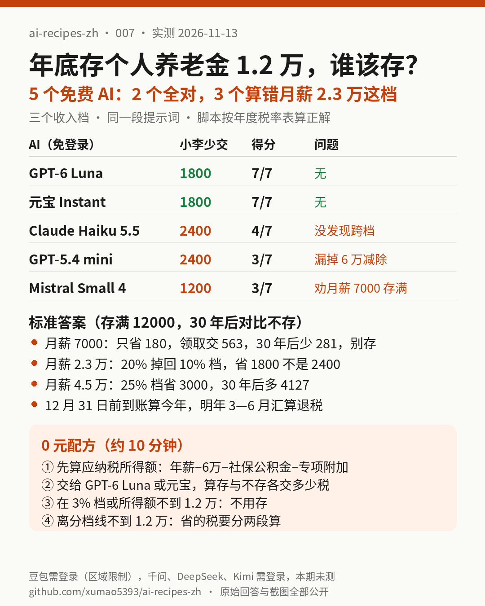

# 007｜年底存个人养老金 1.2 万能退多少税？5 个免费 AI 帮你算：2 个全对，3 个把月薪 2.3 万这档算错，1 个劝低收入者存满

> 实测日期：2026-11-13（美东时间上午）。全部免登录、0 元完成，实测 5 个：duck.ai 上的 GPT-6 Luna、Claude Haiku 5.5、GPT-5.4 mini、Mistral Small 4，以及腾讯元宝（访客模式，界面显示 Instant）。豆包打开后跳转到“受区域限制，请先登录”页面，记为**本期未测**（[截图](assets/007/screenshots/doubao-login-wall.png)）。千问、DeepSeek、Kimi、ChatGPT、Grok 在上一期（006）点发送就要求登录，本期没有再尝试，同样记为**本期未测**。

## 一句话结论

**“12 月 31 日前存 12000 元能退税”不是人人都划算：月薪 7000（应纳税所得额只有 6000 元）的人存满只能省 180 元，退休领取时却要按全额交约 563 元税，30 年后反而少 281 元，不该存；月薪 2.3 万的人存满会从 20% 档掉回 10% 档，只省 1800 元，不是很多人以为的 2400 元。5 个免费 AI 里，GPT-6 Luna 和元宝 7 项全对；Claude Haiku 5.5、GPT-5.4 mini、Mistral Small 4 都把月薪 2.3 万这一档算错了，Mistral 还明知月薪 7000 的人会亏，依然建议存满。**

[提示词](assets/007/prompt.txt) · [计算脚本](assets/007/calc.py) · [标准答案](assets/007/answer_key.json) · [原始回答](assets/007/answers/) · [截图](assets/007/screenshots/) · [评分表](assets/007/scoring.json)

## 要解决的问题

每年 11、12 月，银行 App 和同事群都会推“个人养老金存 12000 元，能退税”。它确实能退税，但它是**递延纳税**：现在少交的税，退休领取时要按 3% 补回一部分，钱还要锁到退休。到底谁该存、存多少，取决于你自己的税率档。

把三个人的工资条件交给 AI 算，是普通人最顺手的做法。本期只问一件事：**免费 AI 给出的“存不存、存多少、能退多少”，能不能直接照做？**

## 先把两个词说清楚

- **应纳税所得额**：一年工资减去 6 万元基本减除费用、社保公积金个人部分、专项附加扣除（租房、子女教育等）之后剩下的数。个税按这个数分档算。
- **递延纳税**：现在存进去的钱先不算收入、不交税；等退休领出来时，**领取的全部金额（本金加收益）**单独按 3% 交税。所以只有当你现在的税率明显高于 3% 时，存进去才有赚头。

政策依据（引用的外部规定，不是我们的测试结果）：[财政部 税务总局公告 2024 年第 21 号](https://www.gov.cn/zhengce/zhengceku/202412/content_6992498.htm)规定缴费按每年 12000 元限额在综合所得中据实扣除，投资收益暂不征税，领取时单独按 3% 计税；[上海发布 2026-01-16 的问答](https://www.shanghai.gov.cn/xbhygq/20260116/adc54e5541244f309c64685858d49b94.html)写明“每年 12 月 31 日前缴存个人养老金，可在限额内据实享受当年度个人所得税扣除”。

## 实测设计

1. **一个具体的场景**（[prompt.txt](assets/007/prompt.txt)）：小王月薪 7000、社保公积金 1500/月；小李月薪 23000、社保公积金 4000/月、租房扣除 1500/月；小张月薪 45000、社保公积金 6000/月、子女教育扣除 2000/月。存进去的钱买年化 1.5% 的养老储蓄，30 年后一次领取；不存的话放普通定期，同样 1.5%，退回来的税也存进去。三个人都是编的示例，不是真实个人。
2. **标准答案用脚本算**（[calc.py](assets/007/calc.py)，Python 无第三方依赖，按综合所得年度税率表），结果在 [answer_key.json](assets/007/answer_key.json)。
3. **同一段提示词**，每个模型新开对话、默认设置，不手动开关联网或深度思考。duck.ai 用自带导出功能保存原文（[answers/](assets/007/answers/)，每个文件第一行写明模型）；元宝没有导出功能，回答原文从页面文字复制到 [yuanbao.transcribed.txt](assets/007/answers/yuanbao.transcribed.txt)，另有 6 张滚动截图覆盖全文（[p1](assets/007/screenshots/yuanbao-p1.png)–[p6](assets/007/screenshots/yuanbao-p6.png)）可以对照。

## 标准答案

| | 小王 | 小李 | 小张 |
|---|---|---|---|
| 应纳税所得额 | 6000 | 150000 | 384000 |
| 税率档 | 3% | 20%（存满后掉到 10% 档） | 25% |
| 存满 12000，2026 年少交 | **180**（只有 6000 元扣得掉） | **1800**（不是 2400） | **3000** |
| 30 年后账户 | 18756.96 | 18756.96 | 18756.96 |
| 领取时交税（全额 3%） | 562.71 | 562.71 | 562.71 |
| 30 年后比“不存”多出 | **−281.36** | **+2250.83** | **+4126.53** |
| 建议 | **不存**（最多存 6000，也只是打平，还锁 30 年） | 存满 | 存满 |

12 月 28 日存：只要 12 月 31 日前到账就算 2026 年扣除。没在单位预扣环节扣的，在 2027 年 3 月 1 日—6 月 30 日个税年度汇算时申报退税。

## 5 个 AI 的成绩

每项 1 分，共 7 项：三个人当年少交的税各 1 分；领取税约 563 元 1 分（±2 元）；三个人 30 年净差 1 分（都在 ±5 元内才给）；“谁存谁不存”的建议 1 分；12 月 28 日问题 1 分（说法里不能有错）。逐项打分见 [scoring.json](assets/007/scoring.json)。

| AI（免登录） | 小王少交 | 小李少交 | 小张少交 | 领取税 | 30 年净差 | 建议 | 12/28 | 得分 |
|---|---|---|---|---|---|---|---|---|
| GPT-6 Luna | 180 ✅ | 1800 ✅ | 3000 ✅ | 562.67 ✅ | ✅ | ✅ | ✅ | **7/7** |
| 元宝 Instant | 180 ✅ | 1800 ✅ | 3000 ✅ | 562.72 ✅ | ✅ | ✅ | ✅ | **7/7** |
| Claude Haiku 5.5 | 180 ✅ | 2400 ❌ | 3600 ❌ | 约 563 ✅ | ❌ | ✅ | ✅ | **4/7** |
| GPT-5.4 mini | 360 ❌ | 2400 ❌ | 3600 ❌ | 约 563 ✅ | ❌ | ✅ | ✅ | **3/7** |
| Mistral Small 4 | 180 ✅ | 1200 ❌ | 3000 ✅ | 约 563 ✅ | ❌ | 小王也存满 ❌ | “不限于 12 月 31 日前” ❌ | **3/7** |

证据：[GPT-6 Luna](assets/007/screenshots/duckai-gpt6-luna-conclusion.png) · [元宝](assets/007/screenshots/yuanbao-conclusion.png) · [Claude](assets/007/screenshots/duckai-claude-haiku55-conclusion.png) · [GPT-5.4 mini](assets/007/screenshots/duckai-gpt54-mini-conclusion.png) · [Mistral](assets/007/screenshots/duckai-mistral-small4-conclusion.png)

## 发现

1. **跨档是这期最大的坑。** 小李 150000 元在 20% 档，减掉 12000 后是 138000 元，掉回 10% 档，所以只省 1800 元。GPT-6 Luna 和元宝都主动指出“不是 12000×20%”；Claude Haiku 5.5 和 GPT-5.4 mini 直接按 12000×20%=2400 算。
2. **基础税率表也有人查错。** Claude 把 384000 元放进 30% 档（应为 25%），Mistral 把 150000 元放进 10% 档（应为 20%）。
3. **GPT-5.4 mini 漏掉了 6 万元基本减除费用。** 它算出的应纳税所得额是 66000、210000、444000，三档全错，小王因此被算成“省 360 元”。
4. **所有 AI 都知道领取时按全额 3% 交税**，563 元这一项 5 个全对。题目已经把规则写出来了，AI 照抄没问题；出错的都是“自己判断在哪一档”的步骤。
5. **Mistral 自己算出小王会亏 282 元，还建议存满**，理由是“政策鼓励应存尽存”“强制储蓄”。它还说缴费“不限于 12 月 31 日前”，和官方说法不符。
6. **Claude 前后矛盾。** 它的表格写小王“少了约 281 元”，下一段又说“差额为 0”。

## 0 元配方（约 10 分钟）

1. 先自己算出**应纳税所得额**：年工资 − 60000 − 社保公积金个人部分 − 专项附加扣除。个税 App 的“收入纳税明细”里也能看到去年的数。
2. 把这个数和“存满 12000 后的数”一起交给 duck.ai 上的 **GPT-6 Luna**（免登录）或**元宝**（访客模式），问它两种情况各交多少税。本期只有这两个全对。
3. 自己做两个核对：
   - **应纳税所得额小于 12000 元**，或者本来就在 3% 档：基本不用存，存了只是把钱锁到退休。
   - **离分档线（36000、144000、300000、420000……）不到 12000 元**：省的税不是“12000 × 你的税率”，要分两段算。
4. 决定存的话，**12 月 31 日前到账**（别卡最后一天晚上），明年 3—6 月个税汇算时记得申报。

## 谁不需要为此付费

一年算一次的账，本期用到的全部是免费、免登录的模型，**不需要为此开任何 AI 会员**。更重要的是：应纳税所得额很低、或者在 3% 档的人，连个人养老金本身都不必跟风存。

## 局限

- 只测了一组数字、一次回答；同一个模型换个时间再问，结果可能不同。
- 30 年收益按题设 1.5% 计算，没有考虑通胀、政策调整和其他养老金产品的收益波动。
- duck.ai 上的模型是它提供的版本，和各家官网的同名模型不一定完全一样。
- 豆包要求登录，千问、DeepSeek、Kimi 需要登录，本期未测；国内模型等有免费账号后补测。
- 本文不是税务或理财建议；具体以个税 App 和银行页面为准。
