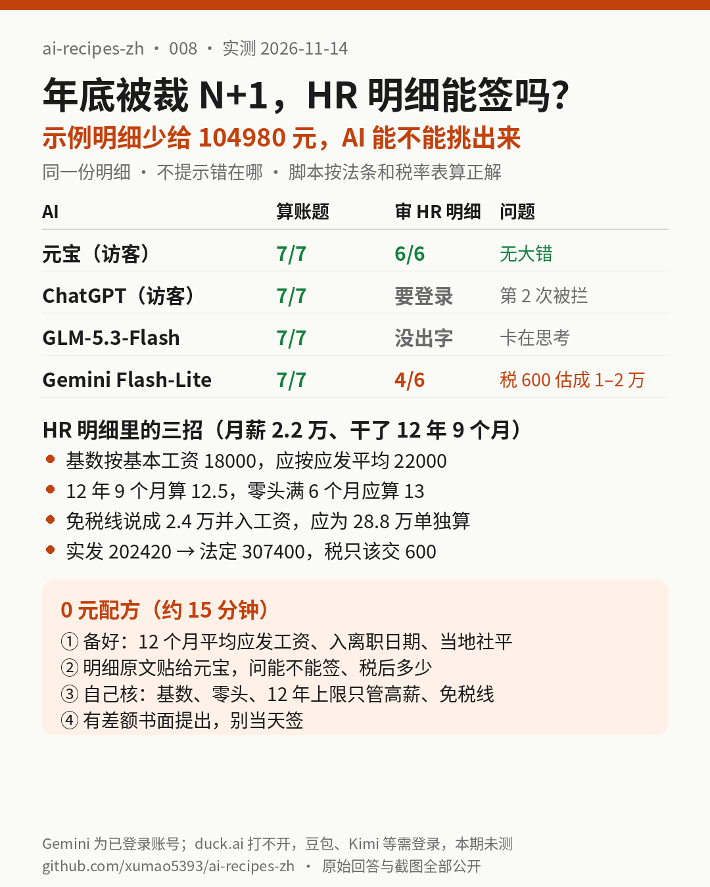

# 008｜年底被裁 N+1，HR 明细能不能签？让免费 AI 核对，少给的 10.5 万能找回来；但 Gemini 快速版把 600 元的税估成 1–2 万

> 实测日期：2026-11-14（美东时间上午）。0 元完成。第 1 轮（标准算账题）实测 4 个：腾讯元宝（访客，Instant）、ChatGPT（未登录访客）、智谱 GLM-5.3-Flash（z.ai 访客）、Gemini 3.5 Flash-Lite；第 2 轮（审 HR 明细）实测 2 个：元宝、Gemini 3.5 Flash-Lite。**Gemini 用的是我们浏览器里已登录的账号**（该账号是付费会员），手动选了免费档也有的“快速解答 3.5 Flash-Lite”，和其他几家“免登录”口径不同，单独标注。ChatGPT 第 2 轮被要求登录、GLM 第 2 轮数分钟没出字，都记为**第 2 轮未测**。往期常用的 duck.ai 今天在我们网络下打不开（整个 duckduckgo.com 域名 TLS 连接被断开），Copilot、Perplexity、Kimi、Grok、LMArena 要求登录，Mistral 要求先接受新条款、Qwen 国际版弹年龄确认，豆包、千问国内版、DeepSeek 需要手机号登录，以上都记为**本期未测**（[截图](assets/008/screenshots/)）。

## 一句话结论

**HR 发来的“N+1”明细，常见三招是：只按基本工资算基数、把 12 年 9 个月算成 12.5 个月、把个税免税线说成“月平均工资 3 倍”并入工资计税。本期示例里这三招加起来让实发少了 104980 元（202420 vs 法定 307400）。把明细原样贴给元宝（免登录），三处问题全部指出、税后到手算对；Gemini 3.5 Flash-Lite 也找出了三处克扣，却把只该交 600 元的税估成“1 万多到 2 万多”。标准算账题 4 个 AI 全对，但有一个用的是 2019 年就废止的旧算法，只是这题碰巧得数一样。**

[提示词 1](assets/008/prompt.txt) · [提示词 2](assets/008/prompt2.txt) · [计算脚本](assets/008/calc.py) · [标准答案](assets/008/answer_key.json) · [原始回答](assets/008/answers/) · [截图](assets/008/screenshots/) · [评分表](assets/008/scoring.json)

## 要解决的问题

年底是裁员高峰。HR 通常给一张“N+1 补偿明细”，要求当天或几天内签字，协议里往往还有一句“签字后再无任何争议”。普通人最顺手的办法是把明细丢给 AI 问“能不能签”。本期测两件事：

1. **AI 会不会算法定的 N+1 和个税？**（第 1 轮，三个人、三种情况）
2. **AI 能不能从一份“看起来很正规”的 HR 明细里挑出少给的钱？**（第 2 轮，更接近真实场景）

## 先把几个词说清楚

- **N**：经济补偿。在公司每干满 1 年给 1 个月工资；零头 6 个月以上按 1 年，不满 6 个月给半个月。
- **月工资**：不是基本工资，是解除前 12 个月的**平均应发工资**（含津贴、绩效、奖金）。
- **双封顶**：月工资超过当地上年职工月平均工资 3 倍的，基数按 3 倍算，**而且年限最多 12 年**。没超 3 倍的人，年限不封顶。
- **+1（代通知金）**：公司没提前 30 天书面通知时额外给的一个月工资，按上个月工资算，不受 3 倍封顶。
- **个税免税线**：当地上年职工**年**平均工资的 3 倍以内免税；超过的部分**不并入**当年工资，单独按年度综合所得税率表算。

规则出处（引用的外部规定，不是我们的测试结果）：《劳动合同法》第四十条、第四十七条（[中国政府网公报全文](https://www.gov.cn/gongbao/content/2007/content_711013.htm)）；《劳动合同法实施条例》第二十条（代通知金按上月工资）、第二十七条（月工资含奖金津贴）；[财税〔2018〕164 号](https://www.gov.cn/zhengce/zhengceku/2018-12/31/content_5440172.htm)第五条第（一）项（3 倍以内免税，超过部分不并入当年综合所得、单独适用综合所得税率表），同文第九条废止了财税〔2001〕157 号第一条（旧的“除以工作年限、按月计税”方法）。

## 实测设计

1. **第 1 轮**（[prompt.txt](assets/008/prompt.txt)）：当地月平均工资 8000 元。小周月薪 8000、干了 3 年 4 个月；小吴月薪 22000、干了 12 年 9 个月；小郑月薪 50000、干了 15 年 2 个月。问 N、+1、个税、税后、要不要并入工资、小郑的 15.5 个月对不对。人物都是编的示例。
2. **第 2 轮**（[prompt2.txt](assets/008/prompt2.txt)）：小吴同款数据，换成一份 HR 明细：按基本工资 18000 算基数、按 12.5 年算、+1 也按 18000、“超过 24000 的部分并入 12 月工资计税，预扣 40580 元”、外加“签字后再无争议”条款。只问“有没有问题、能不能签、应该拿多少”。**不提示错在哪。**
3. **标准答案用脚本算**（[calc.py](assets/008/calc.py)，Python 无第三方依赖），结果在 [answer_key.json](assets/008/answer_key.json)。
4. 每个模型新开对话、默认设置，不手动开联网或深度思考（Gemini 第 1 轮自己触发了联网搜索，见[截图](assets/008/screenshots/r1-gemini-flashlite-start.png)）。回答用页面自带“复制”按钮原样保存到 [answers/](assets/008/answers/)，每个文件第一行写明网站、模型和登录状态。Gemini 截图裁掉了左侧账号历史栏。

## 标准答案

**第 1 轮**

| | 小周 | 小吴 | 小郑 |
|---|---|---|---|
| N 月数 | 3.5 | **13**（9 个月零头按 1 年；没超 3 倍，不受 12 年上限） | **12**（超 3 倍，双封顶） |
| N 金额 | 28000 | 286000 | **288000**（24000×12） |
| +1 | 8000 | 22000 | **50000**（不封顶） |
| 合计 | 36000 | 308000 | 338000 |
| 超过 288000 的部分 | 0 | 20000 | 50000 |
| 个税 | 0 | **600** | **2480** |
| 税后 | 36000 | 307400 | 335520 |

不并入 2026 年工资。小郑的 15.5×50000 不是法定标准，HR 说得对（公司愿意多给不违法）。

**第 2 轮**：法定应发 308000、个税 600、实发 **307400**；HR 版实发 202420。税前少给 65000，个税多扣 39980，**合计少拿 104980 元**。

## AI 的成绩

**第 1 轮**（7 项，每项 1 分，见 [scoring.json](assets/008/scoring.json)）

| AI | 三人合计 | 个税 | 不并入 | 小郑 15.5 个月 | 得分 | 备注 |
|---|---|---|---|---|---|---|
| 元宝 Instant（访客） | ✅ | ✅ | ✅ | ✅ | **7/7** | 附加假设里一处小算错（24000×3% 写成 600） |
| ChatGPT（未登录访客） | ✅ | ✅ | ✅ | ✅ | **7/7** | 主动提醒别用旧的“除以年限”算法 |
| GLM-5.3-Flash（访客） | ✅ | ✅ | ✅ | ✅ | **7/7** | 还提醒“+1 是否算补偿”有地区口径分歧 |
| Gemini 3.5 Flash-Lite（已登录） | ✅ | ✅（方法过时） | ✅ | ✅ | **7/7** | 用的是已废止的“分摊到月”算法，本题碰巧得数相同 |

证据：[元宝](assets/008/screenshots/r1-yuanbao-conclusion.png) · [ChatGPT](assets/008/screenshots/r1-chatgpt-guest-conclusion.png) · [GLM](assets/008/screenshots/r1-glm53flash-conclusion.png) · [Gemini](assets/008/screenshots/r1-gemini-flashlite-conclusion.png)

**第 2 轮**（6 项）

| AI | 年限 13 | 基数 22000 | +1 22000 | 免税线/不并入 | 税 600、到手 307400 | 建议先别签 | 得分 |
|---|---|---|---|---|---|---|---|
| 元宝 Instant（访客） | ✅ | ✅ | ✅ | ✅ | ✅ | ✅ | **6/6** |
| Gemini 3.5 Flash-Lite（已登录） | ✅ | ✅ | ✅ | ❌ 猜成 12.5×24000 | ❌ 估税 1–2 万、到手 28.5–29.5 万 | ✅ | **4/6** |

证据：[元宝](assets/008/screenshots/r2-yuanbao-conclusion.png) · [Gemini](assets/008/screenshots/r2-gemini-flashlite-conclusion.png)

## 发现

1. **“给规则让它算”和“让它自己找错”是两回事。** 第 1 轮题目把封顶线、免税额都写清楚了，4 个全对；第 2 轮只给一份 HR 明细，Gemini 就在个税上露馅了。
2. **Gemini 的错会直接让人少要钱。** 它说“合理税后到手应在 28.5 万至 29.5 万之间”。如果 HR 改口给 29 万实发，按它的说法“合理”，但法定是 307400，还差 1.7 万多。
3. **旧算法还在 AI 脑子里。** Gemini 两轮都用“超额部分除以年限、按月算税”的旧方法（财税〔2001〕157 号第一条，2019 年已废止）。第 1 轮因为分摊 12 年、月度表恰好是年度表的 1/12，得数没差；第 2 轮它连免税额都没算对。
4. **元宝第 2 轮最实用**：逐条指出三处克扣、个税多扣 39980，还给了第 8 条的改法（手写保留对差额的追索权）。小瑕疵：开头写“多 67000 元”，正文算的是 65000 元。
5. **它关于“签了基本锁死”的说法**（元宝称差额不到 50% 一般够不上显失公平）是 AI 的法律意见，我们没有核实，只作参考，涉及金额大的请找当地劳动仲裁或律师咨询。
6. **免登录的路越来越窄。** 今天 ChatGPT 访客只给了 1 次回答，第 2 次就要求登录；duck.ai 打不开；Copilot、Perplexity、Kimi、Grok 都要求登录。元宝访客模式是本期唯一两轮都能用的免登录选择。

## 0 元配方（约 15 分钟）

1. **先把三个数备好**：解除前 12 个月平均**应发**工资（工资条或个税 App“收入纳税明细”里看）、入职和解除日期、当地上年职工月平均工资（当地人社或统计局公布）。
2. **把 HR 明细原文 + 这三个数一起贴给元宝**（访客即可），问“有没有问题、能不能签、法定应拿多少、税后多少”。本期它两轮全对。
3. **自己做 4 个核对**，任何 AI 的回答都要过一遍：
   - 基数是不是“应发平均工资”，不是基本工资；
   - 零头 6 个月以上是不是按 1 年；
   - 月工资没超当地 3 倍的，年限不应被封顶在 12 年；
   - 个税：免税额 = 当地上年**年**平均工资 × 3，超过部分单独按年度表算，不并入 12 月工资。
4. **AI 给出的税额和“超过免税额部分 × 3%/10%/20%”差得很远时，按第 3 步重算**，别信“大致测算”。
5. 有差额就**书面（邮件/微信）提出**，别当天签。“再无争议”条款怎么改，以当地劳动仲裁或律师意见为准。

## 谁不需要为此付费

这是一辈子可能就遇到一两次的事。本期全对的元宝、ChatGPT（第 1 轮）、GLM-5.3-Flash 都是免费、免登录用的；Gemini 我们用的是已登录的账号，换成付费更强的模型也许能算对，但本期没测，**不能说付费更好**。为这件事开任何 AI 会员都没必要，真正值得花钱的是在金额大、公司不让步时找劳动法律师。

## 局限

- 只测了一组数字、每个模型一次回答；同一个模型换个时间再问，结果可能不同。
- 第 2 轮只有 2 个模型给出了回答，样本很小。
- Gemini 用的是已登录的付费账号下的 Flash-Lite 模型，和未登录免费用户看到的不一定完全一样。
- “+1 是否算一次性补偿收入”有地区口径分歧（GLM 提到的安徽答疑我们没有核实），本期按题设“公司全部按一次性补偿收入发放”算。
- 豆包、千问国内版、DeepSeek、Kimi 需要登录，本期未测；有免费账号后补测。
- 本文不是法律或税务建议；具体以当地人社、税务部门和仲裁机构为准。
